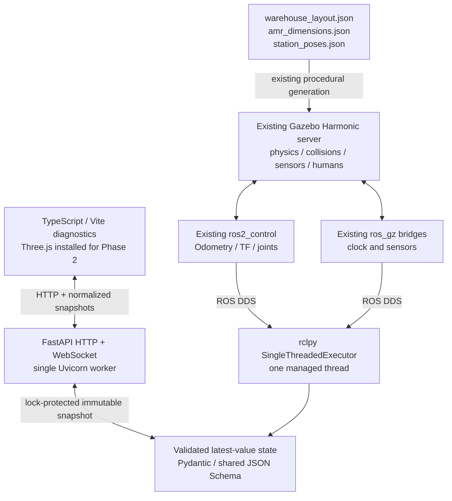

# Digital Twin architecture — Phase 1

## Repository audit (before implementation)

The clean starting branch was `main`. The workspace contains `amr_description`
(ament_cmake), `amr_simulation` (ament_cmake), `my_cpp_pkg` and `my_py_pkg`.
No applicable AGENTS.md was found. Existing generated assets and validation
records are retained. No robot geometry or simulation behavior needs changing.

`amr_description` generates a 15-link, 14-joint Xacro AMR from
`config/amr_dimensions.json`, using eight local STL visuals and primitive
collisions. `gz_ros2_control` drives the wheel velocity interfaces;
`diff_drive_controller` publishes `/odom` and `odom → base_link`. Commands are
`geometry_msgs/msg/TwistStamped` on `/cmd_vel`, with a 0.5 s controller timeout.
The model includes LiDAR, IMU and RGB-D sensors; sensor bridges use best effort.

`amr_simulation` derives local SDF models, four worlds, station poses and a hash
manifest from `warehouse_layout.json`, scenario overrides and AMR dimensions.
Its CMake build runs the deterministic generator. `HumanSystem.cc` applies
physical forces and animates human visuals; it is not a tracking interface.
`warehouse.launch.py` validates generated hashes, obtains spawn (-11, 0, .015),
sets an explicit or unique `GZ_PARTITION`, includes `sim.launch.py`, adds the
warehouse camera bridge and camera static transforms. The AMR launch owns
`gz sim -r -s --headless-rendering`, spawns the robot, then activates controllers.
GUI and RViz are optional. Existing bridges must not be duplicated.

The world uses east/north/up in metres; odometry starts locally. There is no
verified world-to-odom or map-to-odom transform. Static station poses are world
coordinates and explicitly require registration before use as map goals.

Existing validation includes warehouse generation and launch pytest suites,
AMR URDF/runtime/smoke validators, physical warehouse scenario acceptance and
recorded evidence. New evidence will be stored separately.

Environment audit: Ubuntu 24.04.4, Python 3.12.3, ROS Jazzy/rclpy 7.1.11,
Gazebo Sim 8.15.0. FastAPI/Pydantic/Uvicorn/WebSockets are missing. Node 18.19.1
is below current Vite requirements. Use isolated project Python and Node tools;
do not change the system ROS Python installation.

## Implementation design

One managed rclpy executor thread hands validated latest-value telemetry through
a lock to the FastAPI event loop. A timed async publisher produces one normalized
snapshot and one JSON serialization per tick, with a capacity-one queue per
WebSocket client and a send deadline. The browser validates the shared schema.
Protocol types are generated from the Python models via JSON Schema.

The frontend has no ROS connection and sends no commands. ROS remains the
robotics middleware; Gazebo remains the only physics engine. The original
warehouse/AMR launch files, meshes, controllers and bridges are unchanged.
`digital_twin.launch.py` includes the existing warehouse launch once with GUI and
RViz disabled. All four scenarios pass through its existing selection logic.
It does not assign a partition or ROS domain; the existing warehouse launch
continues to own partition creation/inheritance. Gateway exit shuts the composed
launch down, just as Gazebo exit already does in the existing AMR launch.

## Concurrency and bounded resources

FastAPI lifespan creates one private rclpy Context, one Node and one executor
thread. ROS signal handlers are disabled; Uvicorn owns process signals. ROS
callbacks normalize odometry then replace immutable records under a short lock.
TF, static TF and joint-state subscriptions record receipts and counts only;
they do not forward their arrays or construct a localization transform.

The asyncio publisher waits on a timer (10 Hz by default), builds a snapshot
under the same lock, then serializes it once outside the lock. A capacity-one
asyncio queue belongs to each WebSocket client. A new snapshot replaces an
unsent older snapshot; a blocked send has a 2 s deadline. Each client has its own
sender and receiver task. The API loop never waits for one client's network I/O
while broadcasting to others. Default cap: 64 clients. DDS live queues use depth
1 and best effort; static TF uses reliable/transient-local depth 100, accepting
latched transforms for a Gateway that joins late. No telemetry history is kept.

Shutdown cancels the publisher, closes sockets, stops the executor, joins its
thread, destroys the Node and shuts down its Context. Incoming WebSocket messages
are rejected. Uvicorn receive size/queue are bounded at 4096 bytes/one message.
Duplicate terminal + launch SIGINT signals are coalesced so Uvicorn does not skip
lifespan cleanup. ROS launch retains process termination escalation. Use one
worker, no reload: multiple workers would create multiple independent ROS nodes
and sequences. An executor failure marks ROS offline; API health remains distinct.

## State and coordinates

Robot IDs and odometry/joint topics are configurable as an array, with defaults
matching the existing AMR. Shared `/clock`, `/tf` and `/tf_static` topic names are
also configurable. TwinState is already an array of independent robot states;
this is telemetry extensibility, not fleet management.

Pose is copied from `Odometry.pose.pose` in `header.frame_id`; velocity is copied
from `twist.twist` in `child_frame_id`. Quaternion components are preserved, not
converted to Euler angles or silently normalized. Missing pose/velocity/frames
are null. Old values are retained with explicit stale/offline status and age.
No world/odom equivalence, spawn-offset transform or global pose is fabricated.
The world frame comes from the existing installed layout. Phase 1 performs no
rendering coordinate conversion. Phase 2 must explicitly register frames before
placing local odometry in a world scene, and handle ROS Z-up versus rendering axes.

Simulation availability means **recent advancing `/clock`**, not verified Gazebo
process health. A paused or silent simulator becomes stale then offline; repeated
identical clock samples do not imply running. Clock resets are tolerated. Another
clock source in the same ROS domain could also satisfy this check; isolate domains
for independent simulations. Scenario comes from launch/environment configuration,
not inferred from telemetry; standalone Gateway defaults to an unspecified scenario.

## Future boundaries

SLAM Toolbox and localization may supply a verified map/odom chain later. Nav2,
Route Server, graph costs/constraints, A*/Dijkstra, missions, and any Open-RMF fleet
adapter belong behind ROS/backend interfaces. Route Server availability must be
checked against the future selected Jazzy package/backport; no navigation dependency
is installed here. The renderer will consume state and derived configuration, not
plan routes or duplicate physics. Future commands require a separate validated,
authorized interface and must not be inferred from this read-only socket.

Static station exposure is deferred: `stations`, `humans` and `obstacles` are empty
reserved arrays, not statements that these entities do not exist in the simulation.
No dynamic tracking, battery, mission or navigation state is implemented.

## Phase 5 route-planning layer

`amr_route_planner` sits above Nav2 and never below it. It builds a deterministic
world-frame warehouse graph from the layout. It validates every node and connection
against the approved SLAM map through a verified world → map registration. It plans
with A* or Dijkstra, and it executes routes as `NavigateThroughPoses` objectives. The
existing Nav2 planner/controller and the command guard remain the only path to
`/cmd_vel`. Route state reaches the browser through the existing Gateway
(`/api/v1/routes/*`), never through WebSocket v1/v2. See
[Phase 5 graph routing](PHASE_5_GRAPH_ROUTING.md) and
[Phase 5 validation](PHASE_5_VALIDATION.md).

## Official references consulted

- [rclpy Jazzy executor implementation](https://github.com/ros2/rclpy/blob/jazzy/rclpy/rclpy/executors.py)
  and installed Jazzy API signatures for Context/executor shutdown and QoS.
- [ROS 2 Jazzy executors](https://docs.ros.org/en/jazzy/Concepts/Intermediate/About-Executors.html),
  [launch](https://docs.ros.org/en/jazzy/Tutorials/Intermediate/Launch/Launch-Main.html),
  [tf2](https://docs.ros.org/en/jazzy/Concepts/Intermediate/About-Tf2.html).
  The documentation host denied automated access to some pages; official source and
  installed launch/rclpy APIs plus real integration tests supplied compatibility checks.
- [Gazebo Harmonic ROS integration](https://gazebosim.org/docs/harmonic/ros2_integration/),
  [ros_gz_bridge](https://github.com/gazebosim/ros_gz/tree/ros2/ros_gz_bridge).
- [FastAPI lifespan](https://fastapi.tiangolo.com/advanced/events/),
  [WebSockets](https://fastapi.tiangolo.com/advanced/websockets/).
- [Pydantic JSON Schema](https://docs.pydantic.dev/latest/concepts/json_schema/),
  [JSON Schema 2020-12](https://json-schema.org/draft/2020-12).
- [Vite](https://vite.dev/guide/), [TypeScript strict](https://www.typescriptlang.org/tsconfig/strict.html),
  [Three.js installation](https://threejs.org/manual/pages/installation.html),
  [browser WebSocket API](https://developer.mozilla.org/en-US/docs/Web/API/WebSocket).
- [Nav2 Route Server](https://docs.nav2.org/jazzy/configuration_and_development/configuration_guide/core_servers/route_server/configuring_route_server/),
  [SLAM Toolbox](https://github.com/SteveMacenski/slam_toolbox),
  [RMF Web](https://github.com/open-rmf/rmf-web), consulted only for future boundaries.
