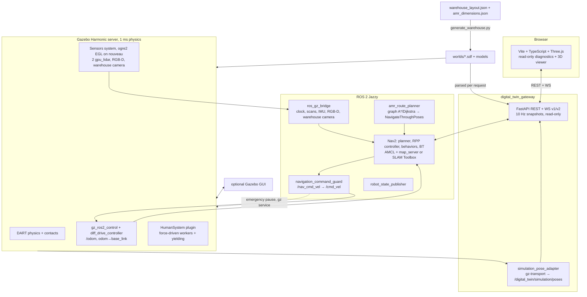

# Phase 6 — Performance diagnostic (before the lite migration)

Scope: find out, with measurements, why AMRs and workers move slowly, why the scene
stutters and why Gazebo saturates the machine. Nothing in the robot, world, Nav2 or
SLAM configuration was changed for these measurements.

Branch `feature/phase5-1-remediation` at `c508333`, clean tree, installed workspace as
built on 2026-10-29. Evidence: `docs/digital-twin/evidence-phase6/baseline/` (ignored by
Git, like earlier evidence), including the measurement scripts in `scripts/`.

## Machine

| Item | Value |
|---|---|
| CPU | Intel Core i5-10300H: **4 physical cores**, 8 threads |
| RAM | 15 GiB, about 4.1 GiB in use at idle |
| GPU 0 | NVIDIA GTX 1650 Mobile (TU117), **open-source `nouveau` driver** (no proprietary driver installed). Suspended at idle. |
| GPU 1 | Intel UHD (CML GT2, `i915`), drives the display; 20–24 % busy at idle (desktop compositor) |
| Session | Wayland (XWayland on `:0`) |
| Software | Ubuntu 24.04, ROS 2 Jazzy, Gazebo Harmonic (gz-sim 8), Nav2 1.3.13, SLAM Toolbox 2.8.5 |

Gazebo's headless EGL sensor renderer runs on the GTX 1650 through Mesa's nouveau GL
driver (`NOUVEAU_USE_ZINK=0`, the Phase 5.1 workaround for the zink/NVK LiDAR defect).
nouveau cannot reclock Turing GPUs, so that GPU stays at its boot clocks.

## Method

- Every run used its own `ROS_DOMAIN_ID`, `ROS_AUTOMATIC_DISCOVERY_RANGE=LOCALHOST` and
  a unique `GZ_PARTITION`, so no other process on the machine or the network could
  answer. No other simulation was running (checked before each run).
- **Real-time factor (RTF)**: `/clock` sim seconds per wall second, from every `/clock`
  sample, plus 1 s sliding windows (`monitor_topics.py`). For worlds without a robot,
  Gazebo's own `/stats` `real_time_factor`.
- **Topic rates and gaps**: wall-clock arrival times of every message; cameras and point
  clouds are subscribed raw (no deserialization).
- **CPU / memory**: `/proc` per process group, 2 s period (`sample_system.py`).
  Percentages are of **one** thread; 800 % is the whole machine.
- **GPU**: Intel busy % = 1 − RC6 residency; per-process Intel render-engine time from
  `/proc/<pid>/fdinfo`. nouveau exposes no utilization counter; only its runtime power
  state (`active` / `suspended`) is recorded.
- **Browser FPS**: Playwright Chromium, `requestAnimationFrame` intervals over 25 s at
  1600 × 900. Headless Chromium falls back to SwiftShader (software); headed Chromium
  uses the Intel GPU (`ANGLE (Intel, Mesa Intel(R) UHD Graphics (CML GT2), OpenGL ES 3.2)`).
  Both are reported; only the headed run represents a user's browser.
- **WebSocket**: a Python client on `/ws/v2/twin` recording arrival times, payload size
  and how often each entity's source timestamp changes (`ws_probe.py`).
- **Motion**: one Nav2 `NavigateToPose` goal, 20 m along the main aisle, using the
  existing `ros2 run amr_navigation navigate` client.

## Results

### Real-time factor decomposition

| Configuration | RTF | Gazebo CPU | Machine CPU |
|---|---|---|---|
| Warehouse world only (no AMR), as generated: physics 1 ms, 3 force-driven workers, warehouse camera | **0.949** | — | — |
| same, without the rendering `Sensors` system | 0.969 | — | — |
| same, without rendering, 4 ms physics step | 1.000 | — | — |
| + AMR (18 links, `gz_ros2_control` at 100 Hz, bridge), **no rendering** | **0.879** | 122 % | 27 % |
| + AMR sensors rendered (2 `gpu_lidar`, RGB-D 640×480, warehouse camera) | **0.570** | 172 % | 33 % |
| + Gazebo GUI client (`warehouse.launch.py` default `gui:=true`) | 0.413 | 272 % (server + GUI), RSS 3.8 GiB | 48 % |
| Full headless stack (`autonomous_demo.launch.py`: Gazebo + Gateway + AMCL + Nav2 + guard), AMR stopped | **0.358** | 167 % | 54 % |
| same, AMR navigating | **0.312** | 164 % | 61 % |
| same, + current frontend in a GPU browser (144 FPS, uncapped) | **0.243** | 164 % | 65 % |
| same, + current frontend in a software-rendered browser (8 FPS) | 0.210 | 135 % | 85 % |

`/clock` never stalled for more than 100 ms in any run (largest wall gap 69 ms). The
slowness is **uniform**: the whole simulation runs at one third of real time, rather
than freezing intermittently.

### Robot motion (full stack, one goal)

| Measure | Value |
|---|---|
| Path | 19.97 m planned, 19.73 m travelled, goal error 0.17 m / 0.05 rad, 0 recoveries |
| Simulated duration | 45.4 s → **0.43 m/s** in simulation time (Nav2 `desired_linear_vel` 0.45) |
| Wall-clock duration | 143.1 s → **0.134 m/s** observed by a person |
| RTF during the run | 0.31 |

The speed configuration is not the problem: in simulation time the AMR drives at its
configured speed. A person watching sees it 3.2 × slower because the clock runs at 0.31.
The same applies to the workers: 0.85–1.15 m/s configured, about 0.3–0.4 m/s observed.

### Sensor and topic rates (full stack, AMR stopped, wall clock)

| Topic | Configured (sim time) | Measured (wall) | Bandwidth |
|---|---|---|---|
| `/clock` | every physics step (1 kHz) | ≈ 358 Hz | — |
| `/scan` (361 beams, 180°) | 15 Hz | 5.4 Hz | — |
| `/top_scan` (720 beams, 360°) | 10 Hz | 3.6 Hz | — |
| `/odom` | 50 Hz | 17.9 Hz | — |
| `/imu/data` | 100 Hz | 35.8 Hz | — |
| `/camera/image_raw` | 15 Hz | 4.8 Hz | 4.3 MB/s |
| `/camera/depth/image_raw` | 15 Hz | 4.8 Hz | 5.6 MB/s |
| `/camera/points` | 15 Hz | 3.5 Hz | **25.1 MB/s** |
| `/warehouse/camera_01/image_raw` | 10 Hz | 2.8 Hz | 2.5 MB/s |
| `/digital_twin/simulation/poses` (ground truth adapter) | 20 Hz wall | 19.4 Hz | 0.08 MB/s |

Neither Nav2, SLAM, AMCL, the guard nor the Gateway consumes any camera or point-cloud
topic. They are rendered and converted anyway, because `ros_gz_bridge` subscribes to
every configured Gazebo topic (`lazy` is off).

### CPU and memory by process group (full stack, AMR stopped)

| Group | CPU (% of one thread) | RSS |
|---|---|---|
| Gazebo server (physics + sensors + humans) | 167 % | 1.17 GiB |
| Nav2 + AMCL + map server + lifecycle | 61 % | 456 MiB |
| Gateway + ground-truth adapter | 52 % | 205 MiB |
| Command guard | 36 % | 82 MiB |
| `ros_gz_bridge` (2 processes) | 21 % | 168 MiB |
| static TF publishers (warehouse camera) | 7 % | 73 MiB |
| robot_state_publisher | 4 % | 40 MiB |
| **Machine** | 54 % of 8 threads ≈ 4.3 threads busy | 5.8 GiB used |

The Gateway, the guard and the two static TF publishers are mostly idle Python/C++
nodes, but all run with `use_sim_time` and therefore process every `/clock` message
(≈ 358 per second in the full stack). That is where most of their CPU goes.

### GPU

| Run | Intel busy | nouveau | Notes |
|---|---|---|---|
| idle desktop | 20–24 % | suspended | compositor |
| full headless stack | 20 % | active | all sensor rendering on the GTX 1650 via nouveau |
| + Gazebo GUI | 52 % | active | the GUI renders on the Intel GPU |
| + current frontend (GPU) | 68 % | active | browser at 144 FPS, uncapped |
| ATLAS prototype alone | **92 %** | suspended | 120 FPS, uncapped |

### Browser rendering

| Page | Renderer | FPS | Frame p95 | Browser CPU | Notes |
|---|---|---|---|---|---|
| Current frontend (Three.js), live Gazebo stack | Intel GPU | **144** | 7.0 ms | 83 % | 56 draw calls, 26.6 k triangles, 955 shapes, shadow map, no frame > 50 ms |
| same | SwiftShader (headless) | 8 | 133 ms | 384 % | not representative of a user's browser |
| ATLAS prototype (standalone, demo campus) | Intel GPU | **120** | 13.9 ms | 120 % | 10,659 static instances; dynamic instances rebuilt each frame |

Neither frontend is FPS-limited on this machine. Both render as fast as the display
allows, and that has a cost: running the current frontend lowered the simulation's RTF
from 0.31 to 0.24. The Intel GPU shares memory bandwidth with the CPU.

### WebSocket feed regularity (`/ws/v2/twin`, person_crossing, 40 s)

| Measure | Value |
|---|---|
| Messages | 9.9 Hz, payload 9.9 kB, largest arrival gap 118 ms |
| Fresh ground-truth pose per entity | 9.8 Hz, gap p99 104 ms, **max 304 ms** (1 of 393 intervals) |
| Frontend interpolation delay | 120 ms (never extrapolates) |

Any interval longer than the 120 ms interpolation delay makes an entity hold, then jump.
This happened once in 40 s. It is a minor cause of visible stutter, not the main one.

### ATLAS prototype (`~/Downloads/ATLAS_Galpao_Industrial_3D.html`)

The task names `ATLAS_Prototipo_Digital_Twin_3D.html`; the file present is
`ATLAS_Galpao_Industrial_3D.html` (95 kB, 2026-10-31). It was used as the reference.

- A standalone, dependency-free **WebGL 2** engine (not Three.js). It uses one
  instanced draw call per layer and primitive (cube, cylinder, sphere), with
  per-instance position, scale, colour, emission and yaw/tilt/roll.
- It shows a fictional **146 × 108 m** campus with 16 rack rows, production, a
  mezzanine and 8 docks, plus 8 AMRs, 3 forklifts and 16 workers. The ROS warehouse is
  **30 × 20 m**. The two are different scenes, not different renderings of the same
  scene.
- Traffic, workers, loose objects and collisions are simulated inside
  `requestAnimationFrame`. `dt` is clamped to 70 ms, so the simulation slows below
  14 FPS and stops when the tab is hidden. Simulation is coupled to rendering.
- Workers are articulated, procedurally animated rigs (gait, look-around, task poses:
  scan, pick, drop, inspect, kneel, signal). Their speed, heading and current task drive
  the animation, so it can be driven by backend state.
- It already has the features to keep: speed-dependent protective fields
  (free/warning/protective), forklift blue spot and side lines, an object placement tool
  (cone, box, pallet), minimap, view presets, layer toggles, night lighting, follow
  camera, an event log and traffic counters.

## Root causes (ranked by measured effect)

1. **Rendered sensors on a GPU without a performant driver** (RTF 0.88 → 0.57).
   Two `gpu_lidar` sensors render through several cube faces each, and the RGB-D and
   warehouse cameras add more passes. All of them run through nouveau at boot clocks,
   and Gazebo waits for sensor rendering inside the simulation loop.
2. **A 4-core machine saturated by the rest of the stack** (0.57 → 0.36 → 0.31).
   Gazebo takes 1.6–1.7 threads. Nav2/AMCL, the Gateway, the guard and the bridge add
   about 1.9 threads. Machine load reaches about 4.3 of 8 threads, i.e. every physical
   core.
3. **`/clock` at the 1 kHz physics rate**, delivered to every `use_sim_time` node
   (about 358 messages per second each at RTF 0.36). This is most of the Gateway's 52 %
   and the guard's 36 % CPU.
4. **Sensors with no consumer**: RGB-D images plus a 25 MB/s point cloud and the
   warehouse camera image stream are rendered, bridged and published, but nothing uses
   them.
5. **1 ms physics step with an 18-link robot and force-driven workers** (0.95 → 0.88).
   Gazebo itself warns that the 100 Hz controller period is slower than the 1 ms
   physics period.
6. **Everything runs in simulation time**, so every wall-clock-visible speed (AMR,
   workers, timeouts) scales with RTF. Changing speed parameters cannot fix this.
7. **Uncapped browser render loops** (144 FPS, 120 FPS) load the shared Intel GPU and
   the CPU, and slow the simulation further (0.31 → 0.24).
8. **The Gazebo GUI client** (default in `warehouse.launch.py`) costs about one more
   thread and about 30 points of Intel GPU (0.57 → 0.41).
9. Minor: the 120 ms interpolation buffer occasionally underruns (1 in 393 intervals).
   The ATLAS prototype couples its simulation to the frame rate.

Ruled out by measurement: the AMR speed configuration, the WebSocket transport rate,
the frontend frame rate, and periodic simulation stalls.

## Current architecture

## Gazebo dependency inventory

| Component | Gazebo dependency |
|---|---|
| `amr_description/launch/sim.launch.py` | owns `gz sim`, `ros_gz_sim create`, `wait_gazebo.py`, controller spawner, `ros_gz_bridge`, `NOUVEAU_USE_ZINK` |
| `amr_description/urdf/gazebo/*.xacro` | `gz_ros2_control`, `gpu_lidar` ×2, IMU, `rgbd_camera` (only when `gazebo:=true`) |
| `amr_description/config/{bridge.yaml,controllers.yaml}` | bridged topics; `diff_drive_controller` (odometry and `odom → base_link`) runs inside Gazebo |
| `amr_simulation` (generator, worlds, models, `HumanSystem.cc`, `warehouse.launch.py`) | SDF worlds, worker physics and yielding, `GZ_PARTITION`, plugin path, warehouse camera bridge |
| `digital_twin_gateway/ros/simulation_adapter.py` | gz-transport `pose/info` and `scene/info` → ground-truth `TFMessage` |
| `digital_twin_gateway/scene/adapter.py` | parses the generated SDF to build the browser scene |
| `digital_twin_gateway/launch/digital_twin.launch.py`, `amr_navigation/launch/autonomous_demo.launch.py` | include the Gazebo warehouse launch; set `GZ_PARTITION` |
| `amr_navigation/amr_navigation/command_guard.py` | **refuses to start without `GZ_PARTITION`**; emergency pause via `gz service` |
| Mapping/validation scripts (`extend_map_survey.py`, `validate_lidar_rendering.py`, `calibrate_odometry.py`, …) | start Gazebo or read its ground truth |
| Nav2, AMCL, SLAM Toolbox, `amr_route_planner`, Gateway state/REST, frontend | **no direct dependency**: they consume ROS topics/TF or Gateway contracts |

The parts with no direct dependency are the ones to preserve unchanged. Replacing the
producers of `/clock`, `/odom`, `odom → base_link`, `/joint_states`, `/scan`, `/top_scan`,
`/imu/data` and `/digital_twin/simulation/poses` is enough to run them without Gazebo.
