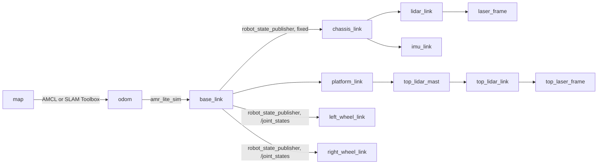

# Phase 6 — Lite runtime: architecture and migration plan

Status: **approved 2026-10-31** with D1 = ATLAS campus (see "Decisions"); **implemented and
validated**: see [PHASE_6_LITE_RUNTIME.md](PHASE_6_LITE_RUNTIME.md) for what was built, the measured
results and the deviations from this plan. The measurements behind every decision are in
[PHASE_6_DIAGNOSTIC.md](PHASE_6_DIAGNOSTIC.md).

## Goals

1. Run the Digital Twin with **no Gazebo process**: ROS 2, Nav2, SLAM Toolbox, AMCL,
   the approved map, the route graph and the sensors stay.
2. Simulation speed independent of rendering: target RTF ≥ 0.95 with the whole stack
   and a browser open, so the AMR and the workers move at their real speed.
3. One scene definition shared by the engine, the Gateway and the browser.
4. The ATLAS visual language in the existing frontend, with two explicit modes:
   **DEMO** (original campus, browser-side) and **LIVE ROS** (backend-authoritative).
5. User-placed obstacles only, reaching the engine, the sensors and Nav2.
6. Industrial monitoring cameras with geometric coverage (no fake detection).
7. Gazebo kept as an optional, headless `gazebo_validation` mode.

Non-goals: new perception, inference on camera images, fleet management, multi-robot
Nav2 (the engine supports N robots, but validation covers one AMR first, as required).

## Target architecture

```mermaid
flowchart TB
  subgraph FE[Frontend 3D — presentation only]
    Shell[ATLAS shell: panels, minimap, view presets, layers, tools, event log]
    Live[LIVE ROS: world-state client, bounded interpolation, stale marking]
    Demo[DEMO: original ATLAS campus, fixed-step demo loop]
    R[Instanced renderer: Three.js + ATLAS shaders<br/>FPS cap, adaptive resolution, LOD]
  end
  subgraph GW[Gateway — FastAPI]
    WS[WS /ws/v1/world → world-state.v1 at 20 Hz]
    REST[REST: scene.v1, obstacles, missions, health<br/>legacy twin v1/v2 + routes unchanged]
  end
  subgraph ROS[ROS 2 — robotics]
    Nav[Nav2 + AMCL or SLAM Toolbox<br/>parameters unchanged]
    Guard[command guard, backend-agnostic]
    Route[amr_route_planner<br/>(Nav2 Route Server evaluated)]
    RSP[robot_state_publisher, URDF gazebo:=false]
  end
  subgraph LITE[amr_lite_sim — lightweight engine, one process]
    Loop[fixed-step loop, owns /clock, RTF pacing]
    Kin[differential drive, limits, 2D collisions]
    Lid[2D LiDAR ray casting on scene slices]
    Ag[workers + forklifts, yielding]
    Obs[obstacle store, user-defined only]
  end
  Layout[warehouse_layout.json + amr_dimensions.json + URDF] --> Compiler[scene compiler]
  Compiler --> Scene[scene.v1.json<br/>visual + collision primitives, zones,<br/>stations, cameras, routes, hash]
  Compiler -. optional .-> SDF[validation SDF for Gazebo]
  Scene --> LITE
  Scene --> GW
  LITE -->|/clock /odom /tf /joint_states<br/>/scan /top_scan /imu/data| ROS
  LITE -->|/lite_sim/world_state, events, obstacles| GW
  Nav --> Guard -->|/cmd_vel| LITE
  GW -->|services: obstacles| LITE
  GW -->|actions: missions| Route
  GW <--> FE
  SDF -.-> GZ[gazebo_validation: headless, simplified, LiDAR only]
```

Rules that keep the subsystems independent:

- The engine never waits on the Gateway or the browser. Closing or freezing the browser
  cannot slow it down.
- The browser never advances the LIVE world. It interpolates between backend samples,
  never extrapolates, and marks entities stale when samples stop.
- ROS nodes see only standard topics, TF and actions. Nav2, AMCL, SLAM and the route
  planner do not know which backend produces them.

## Decisions

Confirmed by the user on 2026-10-31: **D1 = the 146 × 108 m ATLAS campus becomes the
authoritative LIVE scene** (not the recommendation below), D2, D3 and D4 as recommended.
D5 and D6 follow from D1 as described in "Campus adoption".

| # | Decision | Recommendation | Alternatives and cost |
|---|---|---|---|
| D1 | Authoritative LIVE scene | The **existing 30 × 20 m ROS warehouse**, restyled in the ATLAS language. The 146 × 108 m ATLAS campus stays in DEMO. | Make the campus authoritative: new layout, a new SLAM survey of about 1 km of identical aisles, a new graph and stations, and the Nav2/SLAM tuning redone. Weeks, high risk. |
| D2 | Frontend rendering | Port the ATLAS renderer **onto Three.js**: ATLAS vertex/fragment shaders as a `RawShaderMaterial` on `InstancedBufferGeometry`, with the same 13-float instance layout. Port the builders, worker rig and vehicle/field drawing nearly verbatim into TypeScript modules. Three.js keeps the camera, controls, picking and GLB loading. | (b) Embed the raw WebGL2 engine as-is: least porting, but drops the Phase 2 Three.js decision. (c) Rebuild everything with standard Three.js materials: rewrites working visuals and animation. |
| D3 | Temporary objects | Remove the 3 cones (`receiving_cone`, `dispatch_cone`, scenario `aisle_warning_cone`) and the scenario obstacles (`aisle_pallet`, `corridor_barrier`). **Keep** the building, racks and their loads, stations, charger, station floor pallets and parked equipment (forklift, carts, bins, crates) as permanent structure. | Also treat station floor pallets and parked carts/crates as temporary. |
| D4 | Engine implementation | **Python 3 + NumPy** (`ament_python`), matching the codebase. The LiDAR uses polar rasterization of scene segments (below), estimated well under one core. | C++ (`rclcpp`): lower jitter, more code and build time. Revisit only if the measured budget is missed. |
| D5 | Engine interfaces | New `amr_lite_interfaces` package (typed msgs/srvs), so `ros2 topic echo`, rosbag and the recorder see typed data. | JSON in `std_msgs/String`, as `/route_planner/status` does. |
| D6 | Production map | Keep the approved map (`candidate-v11`), its registration and the graph for both modes. Run SLAM on lite data and evaluate the result with the existing quality gates; promotion stays an operator decision, as in Phase 5.1. | Switch to a lite-built map immediately. |

## Campus adoption (consequences of D1)

- **Scene source**: the ATLAS builders (ground, architecture, storage, production,
  mezzanine, docks, details, colliders), with their seeded generator, become the
  campus source. A Node compiler runs those builders and writes one
  `atlas_campus.scene.json`. Static geometry is no longer generated in the browser,
  in either mode. The 30 × 20 m warehouse (layout, SDF, approved map, graph) stays in the
  repository, untouched, for the existing Gazebo validation tooling.
- **Axes**: ATLAS (x, y up, z south) → ROS world (x east, y north = −z_ATLAS, z up).
  "Armazenagem Norte" (z_ATLAS = −40) is at y = +40.
- **Robot**: the simulated AMR keeps the real robot's URDF, footprint (0.95 × 0.70 m),
  sensors and Nav2 limits. It is drawn in the ATLAS style at its true size. The ATLAS
  1.64 × 1.30 m AMR drawing is only a style reference.
- **AMRs vs. scripted vehicles**: in LIVE, AMRs exist only as Nav2-driven robots (one
  first, as required). The ATLAS demo AMRs driven along drawn loops are not ported to
  LIVE, because the task forbids drawn trajectories in place of real planning.
  Forklifts are human-driven industrial vehicles; they keep their lanes, with the ATLAS
  protective-field behaviour, in the backend.
- **Workers**: the 16 ATLAS workers (roles, routes, task stops, yielding to vehicles,
  side-stepping objects) move to the backend engine. The browser keeps the articulated
  rig and animates it from the reported speed, heading and activity. Mezzanine workers
  live at z = 5.13 m and are ignored by floor-level sensors and collisions.
- **Map**: a new SLAM survey of the campus on lite data (faster than real time is
  allowed). The map is evaluated against the scene's ground-truth occupancy, and the
  Phase 5.1 gates are reused where they apply.
- **Restrictions**: rack bays have no floor-level structure, so a 0.47 m AMR could pass
  under the beams, and the scanners see only uprights. Rack, production-cell and mezzanine
  footprints become Nav2 **keepout** zones (costmap filter mask generated from the
  scene), in addition to the graph restrictions.
- **Graph**: campus corridors, one-way lanes, docks, production cells, chargers and
  storage aisles are defined in the scene's navigation section. The graph (nodes,
  directed edges, costs, restrictions) is built from it and validated against the new
  map. Nav2 Route Server (GeoJSON) is evaluated as the planner for this graph; the
  `amr_route_planner` model is reused where it is not tied to the old layout.
- **Gazebo validation**: a simplified, headless campus world generated from the same
  scene (only primitives that matter at robot height), LiDAR-only AMR.

## 1. Scene: one source, one compiler

With D1 = campus, the source of truth is the ATLAS campus builder set (see "Campus
adoption"). Its compiler writes `atlas_campus.scene.json`, with the sections below and a
content hash. The browser, the Gateway and the engine all load that one file.

| Section | Content | Consumers |
|---|---|---|
| `metadata` | schema version, source hashes, `geometry_sha256` | all; the engine reports the hash it loaded, and the browser refuses LIVE rendering on a mismatch |
| `coordinates` | `world`: x east, y north, z up, metres, radians | all |
| `visual` | primitives in world frame (box, cylinder, sphere, label), category, colour, `layer` (ATLAS-style: ground, architecture, roof, racks, cargo, equipment, markings) | browser |
| `collision` | primitives in world frame with `z_min`/`z_max`, `class` (structure, equipment, load) | engine (body collisions) |
| `sensing` | the same visual primitives; the engine slices them at each scanner height, because `gpu_lidar` saw visual geometry | engine (LiDAR) |
| `zones`, `aisles`, `stations`, `spawns`, `charger` | as today | all |
| `cameras` | id, label, pose (x, y, z, roll, pitch, yaw), horizontal/vertical FOV, near/far range, resolution, future topic | browser, Gateway |
| `agents` | worker routes, speeds, dwell points and activity labels; forklift routes; profile tags (`operations`, `mapping`) | engine |
| `obstacle_catalogue` | user-placeable kinds and sizes: cone 0.42 × 0.42 × 0.7, box 0.62 × 0.52 × 0.5, pallet 1.22 × 1.02 × 1.1 | engine, Gateway, browser |

The Gateway serves the file (`GET /api/v1/world/scene`) and validates it against
`shared/schemas/scene.v1.schema.json`. The browser renders exactly that file. The
current SDF-walking `/api/v1/scene` stays for the diagnostics page.

## 2. Lightweight engine (`amr_lite_sim`)

One process, one fixed-step loop, independent of ROS executor timing:

- **Clock**: step `dt` = 10 ms (configurable). The loop sleeps to the wall-clock
  deadline `t0 + k·dt/target_rtf` and publishes `/clock` at 100 Hz, not 1 kHz.
  Overruns are counted and stepped through without drift, up to a bounded catch-up;
  beyond that the backlog is dropped and the measured RTF reports it. Pause/resume via
  service. `target_rtf` > 1 is allowed (for example, a faster mapping survey).
- **Differential drive**: `/cmd_vel` (`TwistStamped`, as `diff_drive_controller`
  expects); 0.5 s command timeout; velocity and acceleration limits from
  `amr_dimensions.json` (0.7 m/s, 1.5 rad/s, 0.5 m/s², 1.5 rad/s²); exact unicycle
  integration; wheel angles derived for `/joint_states`.
- **Odometry and TF**: `/odom` and `odom → base_link` at 50 Hz, odom origin at the
  spawn pose, exactly as `diff_drive_controller` did. Optional Gaussian slip parameters,
  default zero. `robot_state_publisher` (URDF with `gazebo:=false`) publishes every
  fixed sensor frame and the wheels. Nothing else publishes `odom → base_link`.
  `map → odom` comes from AMCL or SLAM, never both (existing `exclusive_mode` check).
- **Collisions (2D, simplified)**: robot footprint vs. collision primitives whose
  height band overlaps the robot (0.035–0.47 m), user obstacles, worker discs and
  vehicle boxes. A step that would intersect is not applied. The robot state becomes
  `blocked` and a `contact` event names the other entity. There is no contact dynamics
  and no pushing.
- **LiDAR, with no rendering**: at start-up the sensing primitives are sliced at each
  scanner's height (0.213 m front, 0.48 m top, from the URDF chain) into 2D segments;
  discs are polygonised. Each scan transforms segments into the sensor frame,
  back-face-culls them, computes the beam-index interval each segment covers and
  evaluates only those (segment, beam) pairs with a vectorised `minimum.at`. Work scales
  with depth complexity rather than beams × segments. Dynamic entities are appended
  each scan. Output matches the Gazebo messages: 361 beams over 180° at 15 Hz and
  720 beams over 360° at 10 Hz, ranges 0.08/0.12–20 m, frames `laser_frame` /
  `top_laser_frame`, REP-117 ±inf, 1 cm quantisation, optional noise. The stamp is the
  simulation time of acquisition.
- **IMU**: `/imu/data` at 50 Hz from the kinematics (yaw rate, accelerations).
  RGB-D and warehouse-camera images are **not** produced in lite mode. Nothing
  consumed them.
- **Workers**: a port of `HumanSystem` behaviour without forces: waypoint routes,
  speed/acceleration/braking/yaw-rate limits, heading gate, the same yielding
  prediction (AMR envelope, 3 s horizon, hysteresis, bounded wait with route reversal),
  and optional dwell activities at route ends. States: `walking`, `yielding`, `waiting`,
  `working`, `idle`.
- **Forklifts**: route-following loops with a speed-dependent protective field
  (`v²/2b + gap`); they slow or stop for AMRs, workers and obstacles. States: `moving`,
  `slowing`, `stopped`. Profiles: `operations` (workers + forklift), `mapping`
  (no agents, as `mapping_only` was).
- **Obstacles**: user-defined only, validated on placement (inside the building, not
  overlapping structure, robots, workers or other obstacles). They are added to body
  collisions and LiDAR immediately, and published latched.
- **Ground truth**: `/digital_twin/simulation/poses` (`TFMessage`, never `/tf`) in the
  existing format, so the route executor, goal client and evaluation scripts keep working.

| Topic / service | Type | Rate | QoS |
|---|---|---|---|
| `/clock` | `rosgraph_msgs/Clock` | 100 Hz | best effort |
| `/odom` | `nav_msgs/Odometry` | 50 Hz | reliable |
| `/tf` (`odom → base_link`) | `tf2_msgs/TFMessage` | 50 Hz | reliable |
| `/joint_states` | `sensor_msgs/JointState` | 50 Hz | reliable |
| `/scan`, `/top_scan` | `sensor_msgs/LaserScan` | 15 Hz, 10 Hz | sensor data |
| `/imu/data` | `sensor_msgs/Imu` | 50 Hz | sensor data |
| `/lite_sim/world_state` | `amr_lite_interfaces/WorldState` | 30 Hz | best effort, depth 1 |
| `/lite_sim/events` | `amr_lite_interfaces/SimEvent` | on change | reliable, depth 50 |
| `/lite_sim/obstacles` | `amr_lite_interfaces/ObstacleArray` | on change | reliable, transient local |
| `/digital_twin/simulation/poses` | `tf2_msgs/TFMessage` | 20 Hz | best effort |
| `/lite_sim/add_obstacle`, `/remove_obstacle`, `/clear_obstacles`, `/set_paused` | services | — | — |

TF tree in lite mode:



The world → map registration stays evaluation/visualisation data and is never
published as TF (Phase 5 rule).

## 3. ROS 2: Nav2, SLAM, AMCL, routes

- Nav2, AMCL, SLAM Toolbox and route-planner parameters stay **unchanged**. The lite
  sensors reproduce the messages they were tuned on.
- `command_guard` becomes backend-agnostic: a `simulation_backend` parameter
  (`gazebo` | `lite`). In `lite` it neither requires `GZ_PARTITION` nor runs
  `gz service`; its emergency pause calls `/lite_sim/set_paused`. Every other check is
  unchanged: fresh scans, odometry, clock and localization, a single `/cmd_vel` writer,
  and drive limits.
- New launch files in `amr_lite_sim`: `lite.launch.py` (engine + RSP),
  `lite_mapping.launch.py` (mapping profile + SLAM Toolbox),
  `lite_navigation.launch.py` (engine + Gateway + AMCL + Nav2 + guard; the lite
  counterpart of `autonomous_demo.launch.py`).
- **SLAM validation**: survey the warehouse in lite with the existing coverage plan,
  save the map, then run `calibrate_registration`, `evaluate_map.py` and
  `build_graph --check` against it. Report against the same gates as Phase 5.1.
- **Navigation validation with one AMR**: station-to-station goals and graph routes;
  a user obstacle placed in an aisle (detection, slow-down/stop, replan around it); a
  corridor fully blocked (graph replan through another corridor); a worker crossing
  (yield). Then a soak test.
- **Nav2 Route Server**: `nav2_route` 1.3.13 is installed. Export the warehouse graph
  to Route Server GeoJSON in the map frame, run `ComputeRoute` for every station pair and
  compare with `amr_route_planner` (nodes, length, cost). Report whether it can replace,
  or only cross-check, the current planner. The validated executor stays primary until
  that comparison is measured.
- **Safety fields**: the engine evaluates a speed-dependent warning/protective field
  per vehicle against the simulated top scan and reports it; the browser draws it in the
  ATLAS colours. Enforcement (a simulated safety-scanner stop) is a parameter, off by
  default, so Nav2 + guard behaviour stays the validated one. Nav2 `collision_monitor`
  will be evaluated for slow-down/stop polygons if its Jazzy stamped-command support fits
  the guard chain.

## 4. Gateway and contracts

New independently versioned contract `world-state.v1` (Pydantic → JSON Schema →
generated TS types, as before). Twin v1/v2 and the route contracts stay unchanged.

| Field | Content |
|---|---|
| `session_id`, `sequence`, `timestamp`, `server_wall_time` | as twin v2; wall time lets clients measure latency |
| `simulation` | `backend` (`lite`, `gazebo`, `none`), `status` (`running`, `paused`, `stalled`, `offline`, `unknown`), `sim_time`, measured `real_time_factor`, `epoch`, `scene_hash` |
| `connection` | Gateway, ROS, simulation and navigation availability (the existing four-state model) |
| `entities[]` | `id`, `type` (`amr`, `human`, `forklift`), world-frame `x y z yaw`, `vx vy wz`, `state`, `activity`, `stamp`, `age_seconds`, `availability` |
| `robots[]` | navigation status, goal and Nav2 `/plan` transformed to world (≤ 256 points; omitted with a reason if the registration is unverified), safety-field state, localization source and health, active mission |
| `obstacles[]` | user obstacles (`id`, `kind`, pose, size) |
| `events[]` | last N events with monotonically increasing `seq` (contact, protective stop, blocked, replanned, obstacle added/removed, mission state); clients deduplicate by `seq` |

- **Transport**: `WS /ws/v1/world` at 20 Hz, about 2–4 kB per message, one serialization
  per tick, capacity-one queues (unchanged design). `GET /api/v1/world` returns the same
  snapshot for resynchronisation.
- **Commands** (new; previously the Gateway was read-only):
  `POST /api/v1/obstacles`, `DELETE /api/v1/obstacles/{id}`, `DELETE /api/v1/obstacles`,
  `POST /api/v1/missions` (`destination` = station or graph node, `strategy` = `graph` or
  `direct`), `DELETE /api/v1/missions/current`. All are strictly validated, size-bounded
  and limited to the allowed origins on localhost. The backend accepts or rejects; the
  browser shows the result and never applies a change locally first.
- **Disconnects**: the engine keeps running without the Gateway; the Gateway keeps
  serving without ROS (marked `offline`/`stale`, last values kept, nothing
  invented); browsers reconnect with backoff and resynchronise from the next full
  snapshot. Missions survive a browser disconnect.
- Gateway `/clock` subscription is throttled (or replaced by `world_state.sim_time`) so
  that it no longer wakes at the clock rate.

## 5. Frontend

- `index.html` becomes the ATLAS shell (Portuguese UI, as the prototype). The current
  diagnostics page moves to `diagnostics.html`, unchanged, so its tests keep working.
- **Modes**: `LIVE ROS` (default when the Gateway answers) and `DEMO` (explicit toggle,
  or automatic when no Gateway is available, clearly badged). Switching mode tears down
  the other mode's state. No demo traffic runs in LIVE.
- **Module layout**: `atlas/render` (instanced layers, shaders, primitive helpers),
  `atlas/rig` (worker rig and poses, vehicles, fields, loose objects), `atlas/scene`
  (ROS warehouse builder from `scene.v1`; original campus builder), `atlas/demo` (ATLAS
  traffic and workers, fixed-step loop on its own timer), `atlas/live` (world-state
  client, buffers, events, commands), `atlas/ui` (panels, minimap, view presets, layers,
  tools, camera panel).
- **Loops**: the render loop only interpolates and draws. It is capped (60 FPS by
  default, 30 FPS when idle) with adaptive pixel ratio (≤ 1.5, stepping down when frame
  time exceeds budget). The DEMO simulation runs on its own fixed-step timer.
- **Performance**: static layers baked once into instanced buffers; dynamic instances
  written into preallocated typed arrays (no per-frame array growth); shared geometry
  and materials; worker rigs replaced by a simple capsule beyond a camera distance (LOD);
  labels and minimap at reduced cadence; frustum-culled dynamic groups.
- **LIVE rendering**: backend pose/velocity/state drive the ATLAS rigs. Worker gait
  phase integrates the reported speed, task poses follow the reported `activity`, and
  vehicle beacons and fields follow the reported field state. Stale entities are drawn
  dimmed with their age; a ROS/simulation outage banner shows the condition and nothing
  moves.
- **Obstacle tool**: as in ATLAS (cone, box, pallet, click to place, click to remove,
  clear all). The click sends a request; the object appears when the backend confirms
  it. Rejections are shown with the backend's reason.
- **Industrial cameras**: frustum and floor-coverage polygon per camera, toggled per
  layer, selectable from a panel (id, pose, height, FOV, range), with a "view from
  camera" button. Labelled as geometric coverage only.
- **Routes and trajectories**: graph (validated/unmapped/blocked colours), the Nav2
  plan, the graph route and progress, and the goal marker. All are drawn from backend
  data through the verified registration.

Coordinates, explicit in `coords.ts`: ROS world (x east, y north, z up) →
WebGL/Three.js (X = x, Y = z, Z = −y). ATLAS yaw equals ROS yaw (rotation about +Y).
Map ↔ world uses the verified SE(2) registration from the route graph.

## 6. `gazebo_validation` mode

`ros2 launch amr_simulation gazebo_validation.launch.py`: headless server only, no GUI.
The world is a simplified variant from the same compiler: one light, no shadows, no
labels or markings, no warehouse camera. Physics step 4 ms. The AMR uses LiDAR only
(`sensors:=lidar` xacro argument, no RGB-D) and a bridge limited to clock, scans, IMU
and odometry. Purpose: cross-check lite LiDAR against `gpu_lidar` at the same poses
(extending `validate_lidar_rendering.py`) and run the physical contact test. Lite mode
never imports or launches anything from it.

## 7. Migration steps

Each step ends with its own tests and measurements. No step removes the Gazebo path
before the lite path passes.

| Step | Content | Acceptance |
|---|---|---|
| M0 | Diagnostic and baseline | Done: `PHASE_6_DIAGNOSTIC.md` |
| M1 | Scene compiler output `scene.v1.json`, schema, cameras and agents in the layout, temporary objects removed per D3 | schema + hash tests; geometry identical to the SDF for permanent objects |
| M2 | `amr_lite_interfaces`; engine core: loop, clock, drive, odom/TF, joint states, collisions | unit tests (kinematics, limits, timeout, collision); RTF ≥ 0.99 alone |
| M3 | Lite LiDAR + IMU | analytic ray tests; comparison with the existing ray cast at the four Phase 5.1 poses (≤ 2 cm median) |
| M4 | One AMR: SLAM survey on lite data, map evaluation; AMCL + Nav2 with the approved map; guard backend switch | goals to all stations succeed; map passes the Phase 5.1 gates or the gap is reported |
| M5 | Workers and forklift; obstacle store and services | yielding scenario; obstacle in aisle → stop/replan; blocked corridor → graph replan |
| M6 | Gateway `world-state.v1`, commands, Route Server comparison | contract tests; reconnection and ROS-down tests; command validation tests |
| M7 | Frontend ATLAS port: LIVE + DEMO, cameras, minimap, tools | browser tests; screenshots; ≥ 30 FPS with full visualization |
| M8 | `gazebo_validation` mode | lite vs Gazebo LiDAR agreement report |
| M9 | Performance before/after with the same scripts, ≥ 30 min soak, evidence, documentation, limitations | targets below; every claim backed by a run |

## 8. Acceptance targets (measured with the baseline scripts)

| Metric | Baseline (Gazebo) | Target (lite) |
|---|---|---|
| RTF, full stack + browser | 0.24 | ≥ 0.95 |
| AMR wall-clock speed on a straight leg (desired 0.45 m/s) | 0.134 m/s | 0.45 m/s ± 10 % |
| `/scan` / `/top_scan` wall rate | 5.4 / 3.6 Hz | 15 / 10 Hz ± 5 % |
| `/clock` stalls > 100 ms | 0 | 0 |
| Machine CPU, full stack, AMR moving | 61 % | report (expected well under half) |
| Browser FPS, full visualization | 144 uncapped | ≥ 30 at the 60 FPS cap, frame p95 < 33 ms |
| Soak 30 min | not run | no stall, RSS growth < 10 %, no error loop |

## 9. Known limitations and expected regressions

- Lite physics is kinematic: no wheel slip, contact dynamics, tipping or pushing.
  Contacts become geometric stops and events. Physical validation stays with Gazebo.
- Lite LiDAR is an ideal 2D scanner on sliced geometry: no beam divergence,
  reflectivity, multipath or motion distortion. Noise is optional.
- No RGB-D or warehouse-camera images in lite mode; industrial cameras are geometric.
- Workers and forklifts are scripted agents, not people or drivers.
- Python scheduling jitter can delay individual ticks. Overruns are measured and
  reported; C++ (D4) is the fallback if the budget is missed.
- Gazebo-only scenarios (`person_crossing`, `obstacle_in_aisle`, `corridor_blocked`)
  remain for validation; in lite mode those situations are created by placing objects.
- The approved map was built in Gazebo with the cones present; small residual
  differences in those spots are expected.

## 10. Planned commands (after implementation)

```bash
# Lite (default): engine + Nav2/AMCL + guard + Gateway
ros2 launch amr_lite_sim lite_navigation.launch.py
# Lite mapping (no agents) + SLAM Toolbox
ros2 launch amr_lite_sim lite_mapping.launch.py
# Frontend: http://127.0.0.1:5173 (LIVE ROS), ?mode=demo for DEMO
cd web/digital-twin && npm run dev
# Optional physical validation (headless, simplified)
ros2 launch amr_simulation gazebo_validation.launch.py
```
