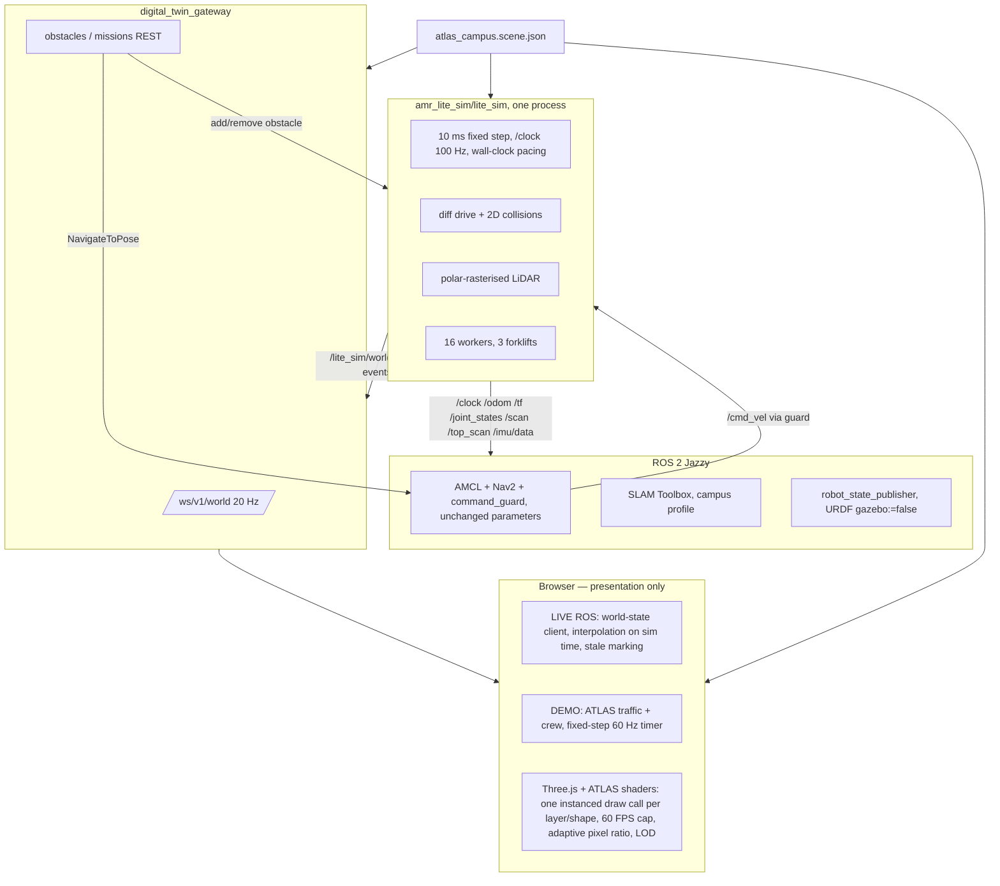

# Phase 6 — Lite runtime (Gazebo-free Digital Twin): implementation and validation

Plan: [PHASE_6_LITE_PLAN.md](PHASE_6_LITE_PLAN.md). Diagnostic: [PHASE_6_DIAGNOSTIC.md](PHASE_6_DIAGNOSTIC.md).
Evidence: `docs/digital-twin/evidence-phase6/` (ignored by Git, like earlier phases).
Everything below was measured on this machine (i5-10300H, 4 cores / 8 threads, Intel UHD for
display, GTX 1650 on nouveau). Nothing was committed or pushed.

## Result

| Metric | Gazebo full stack (before) | Lite full stack (after) |
|---|---|---|
| Real-time factor, stack + browser open | **0.24** | **1.000** |
| AMR wall-clock speed, desired 0.45 m/s | **0.134 m/s** | **0.448 m/s** |
| `/scan` / `/top_scan` / `/odom` wall rate | 5.4 / 3.6 / 17.9 Hz | 15.0 / 10.0 / 50.0 Hz |
| `/clock` stalls > 100 ms | 0 | 0 (largest gap 22 ms) |
| Machine CPU, AMR moving, browser open | 65 % | 42 % |
| Simulator process | Gazebo 164–172 %, 1.17 GiB | lite engine 31–37 %, 0.17–0.20 GiB |
| GTX 1650 (nouveau) | active (sensor rendering) | suspended (nothing rendered server-side) |
| Browser | 144 FPS uncapped (current page) | 59.8 FPS at the 60 FPS cap, frame p95 20.9 ms |
| WebSocket to the browser | 10 Hz (twin v2) | 20 Hz world-state v1, median latency 2.6 ms |
| Workers / forklifts simulated | 3 / 0 | 16 / 3 (ATLAS crew and lanes) |
| 12-mission soak with people, 50 min | not run (motion too slow) | 12/12 succeeded, 0 contacts, 1277 m |

Before: `evidence-phase6/baseline/`. After: `evidence-phase6/after_lite_full_stack/` (same scripts,
now in `src/amr_lite_sim/scripts/perf/`: `monitor_topics.py`, `sample_system.py`, `measure_fps.mjs`,
`ws_probe.py`; operations profile with
16 workers and 3 forklifts, one Nav2 mission running, browser on the LIVE page).

## What was built

| Package / area | Role |
|---|---|
| `src/atlas_scene` (new) | The single scene: Node compiler running the ATLAS builders (unchanged geometry, seed 42930, 10,659 instances — the count the prototype logs) plus LIVE data (wall cladding, spawn, 16 stations, 8 industrial cameras, corridors). Writes `config/atlas_campus.scene.json` and a byte-identical browser copy. Python loader verifies both hashes and slices geometry at any height. |
| `src/amr_lite_interfaces` (new) | `WorldState`, `EntityState`, `Obstacle(Array)`, `SimEvent`, `AddObstacle`, `RemoveObstacle`. |
| `src/amr_lite_sim` (new) | Lite engine (`lite_sim`), survey driver, free-space relay for mapping, launch files (`lite`, `lite_twin`, `lite_mapping`, `lite_navigation`), campus SLAM profile, survey plan, tools (map registration, scan-geometry check, Gazebo comparison, graph export, Route Server evaluation, mission runner). |
| `src/amr_navigation` | `command_guard`: `simulation_backend` parameter (`gazebo` default, `lite`); front scanner may report open space. `initial_pose`: repeats the estimate until AMCL is active. `navigation.launch.py`: `simulation_backend` argument. Campus map `maps/campus.{yaml,pgm}` + verified registration + provenance. The warehouse map is untouched. |
| `src/amr_description` | `sensors` xacro argument (`full` default, `lidar`), `bridge_config` launch argument, `config/bridge_lidar.yaml`. Defaults unchanged. |
| `src/amr_simulation` | `gazebo_validation.launch.py` and `scripts/generate_campus_world.py`. The warehouse worlds, manifest and scenarios are untouched. |
| `src/digital_twin_gateway` | world-state v1 (`/ws/v1/world`, `GET /api/v1/world`, `GET /api/v1/world/scene`), commands (`POST/DELETE /api/v1/obstacles`, `POST/DELETE /api/v1/missions`), world store, registration, GZip. Twin v1/v2 and route contracts unchanged. |
| `shared/schemas` | `world-state.v1`, `command-result.v1` (generated from the Pydantic models). |
| `web/digital-twin` | `index.html` = ATLAS twin (LIVE ROS / DEMO). The Phase 5 page moved unchanged to `diagnostics.html` (its browser tests now open it there). |



## Commands

Prepare each terminal: `cd ~/ros2_ws && source /opt/ros/jazzy/setup.bash && source .venv/bin/activate && source install/setup.bash`.
Build: `colcon build --symlink-install --packages-select atlas_scene amr_lite_interfaces amr_lite_sim amr_navigation amr_description amr_simulation digital_twin_gateway`.

```bash
# LIVE twin: lite engine + workers/forklifts + Gateway + AMCL + Nav2 + guard (no Gazebo process)
ros2 launch amr_lite_sim lite_navigation.launch.py            # profile:=empty for no agents
# Engine + Gateway only (no navigation)
ros2 launch amr_lite_sim lite_twin.launch.py
# SLAM mapping of the campus (no agents), driven by the coverage survey, 3x real time; scanner noise
# 1 cm by default here (lidar_noise_stddev). Run it on an otherwise idle machine: async SLAM skips scans under load
ros2 launch amr_lite_sim lite_mapping.launch.py survey:=true real_time_factor:=3.0
bash src/amr_navigation/scripts/save_map.sh /absolute/path/campus_candidate      # while SLAM runs
python3 src/amr_lite_sim/scripts/register_campus_map.py --map /absolute/path/campus_candidate.yaml --output reg.json
# Frontend (Node >= 22: export PATH=$PWD/.tools/node_modules/.bin:$PATH)
cd web/digital-twin && npm run dev     # http://127.0.0.1:5173 (LIVE ROS), ?mode=demo, /diagnostics.html
# Missions and obstacles from a terminal (same endpoints as the UI)
python3 src/amr_lite_sim/scripts/run_missions.py dock_05 charger_01 --output /tmp/missions.json
curl -X POST localhost:8000/api/v1/obstacles -H 'Content-Type: application/json' -d '{"kind":"pallet","x":2,"y":6}'
# Optional physical validation (headless, simplified campus, LiDAR-only AMR); then compare:
GZ_PARTITION=campus_validation ros2 launch amr_simulation gazebo_validation.launch.py
GZ_PARTITION=campus_validation python3 src/amr_lite_sim/scripts/compare_gazebo_lidar.py --output /tmp/cmp.json
# Scene recompilation (after editing the ATLAS builders or campus_navigation.mjs), then drift check
node src/atlas_scene/compiler/compile.mjs && node src/atlas_scene/compiler/compile.mjs --check
```

## Scene and coordinates

- **Source**: `atlas_campus.mjs` is the prototype's builder code with only the DOM writes removed;
  `campus_navigation.mjs` adds what LIVE needs. The compiler writes every instance in the ROS world
  frame and a `geometry_sha256` and `scene_sha256`; JavaScript and Python compute identical hashes.
  The Gateway serves the same bytes the engine loaded; the browser refuses LIVE geometry whose hash
  differs from the engine's (banner).
- **Axes**: ROS world x east, y north, z up. WebGL/Three.js X = x, Y = z, Z = −y; yaw is the same number
  (`web/digital-twin/src/atlas/coords.ts`). Map ↔ world: `map = R(yaw)·world + (x, y)` from
  `maps/campus_registration.json`, used only for the Nav2 plan and mission goals.
- **Physical model**: each prototype "solid" (racks, conveyor, cells, tables, stairs, fence, pallets,
  chargers, pillars, extinguishers) is the object's envelope: it stops bodies and is seen by floor
  scanners, as in the prototype's own traffic code. The cut-away walls get a 3 m cladding layer
  (`enclosure`), hidden by default in the browser ("Fechamento das paredes").
- **Temporary objects**: none are generated; cones, boxes and pallets exist only when a user places
  them. Permanent structure (racks with cargo, floor pallets, conveyor, cells, chargers, docks,
  trucks, mezzanine) is preserved. The 30 × 20 m warehouse and its Gazebo scenarios stay available
  for the Gazebo tooling only.

## Lite engine

- Fixed 10 ms step paced against the wall clock (`step/target_rtf`), `/clock` at 100 Hz, catch-up
  bounded at 25 steps; overruns and measured RTF go to `/diagnostics` and world-state.
- Differential drive with the robot's limits from `amr_dimensions.json` (0.7 m/s, 1.5 rad/s,
  0.5 m/s², 1.5 rad/s², 0.5 s command timeout), exact arc integration, wheel joint states, odometry
  and `odom → base_link` at 50 Hz with the controller's covariances.
- Collisions: footprint vs structure, obstacles, workers, forklifts; on contact the robot advances to
  the last free fraction of the step and stops (`blocked`, one `contact` event, `released` on backing away).
- LiDAR: both scanners at the URDF mounts; segments of the scene sliced at each scan plane; per scan,
  back-face culling plus polar rasterisation (beam interval per segment). Equal to a brute-force ray
  cast within 1 µm at 8 test poses; 0.4 ms per 720-beam scan.
- Workers: the prototype's behaviour (task stops: scan, pick, drop, inspect, kneel, signal, look
  around; waiting for vehicles; side-stepping objects), plus "never step into a body": a person
  stepping aside for a stopped vehicle moves sideways up to the side-step or the rack and passes
  where the aisle allows (a parked AMR in a 2.3 m rack aisle is passed after < 1 s); otherwise a
  blocked person slides back toward the walked line or stops, one held up for 10 s turns back along
  the walked route (`turned_back` event), and one touching a body may only step away from it. A
  head-on meeting in a rack aisle therefore cannot deadlock.
  Forklifts: the prototype's protective field, yielding, following, back-off and detours on their
  one-way lanes.
- Safety field per vehicle (speed-dependent protective v²/(2·0.5 m/s²) + 0.3 m, warning + 1.0 m),
  reported for every object. For **people** the AMR's field is enforced, as a safety scanner would,
  independently of Nav2: a person in the protective field triggers a safe stop at 1.5 m/s²
  (`protective_stop`, reason `protective_stop:<id>`), reset only when the standstill warning field
  (1.3 m) is clear of people; a person in the warning field limits the speed to 0.3 m/s; reversing
  is not limited. An in-place turn (|v| < 0.05 m/s) with a person inside the swept disc
  (circumscribed radius + 0.15 m) is refused (reason `rotation_stop:<id>`). User obstacles and
  forklifts are left to Nav2 (costmap, replanning) and to the geometric contact stop.
- Cost: 1.3 ms per step on average (p99 3.0 ms) with 16 workers, 3 forklifts and the safety checks
  (1.0 ms before the safety checks were added).

Bugs found and fixed during validation (each with a regression test or a measured re-run): stamp
rounding that made `/clock` jump back ~1 s at some integer seconds (TF buffers cleared; test
`test_time.py`); contact chattering (`test_collision_blocks_motion_and_emits_one_event`); integer
scene values in typed messages; a shutdown race; and, from the first soak (see "Soak"), an AMR–worker
deadlock in a rack aisle, contacts caused by in-place rotation next to a person, a person walking
into the AMR's path faster than Nav2 could react, and a person left pinned inside the margin of a
stopped AMR (`test_worker_steps_aside_and_passes_a_parked_robot`,
`test_worker_turns_back_when_a_parked_robot_blocks_its_side`,
`test_in_place_rotation_refused_with_person_in_swept_area`,
`test_safe_stop_for_a_person_in_the_protective_field`,
`test_person_pinned_against_a_robot_can_step_away`).

## Sensor validation

| Check | Result |
|---|---|
| Published scans projected through TF and ground truth onto the scene, robot moving (`check_scan_geometry.py`) | median and p90 point distance 0.02 m (one 2 cm grid cell), 30 front + 59 360° scans |
| Lite vs Gazebo `gpu_lidar`, same scene, 6 poses (`gazebo_validation`, `compare_gazebo_lidar.py`) | median |Δr| 1–8 mm; returns present on one side only: 0–2 beams per scan; |Δr| ≤ 5 cm on 79–100 % of beams (the rest at grazing incidence along the long aisles, where mm-level pose offsets after `set_pose` become cm) |
| Drive vs Gazebo `diff_drive_controller` (simulation time) | 0 → 0.49 m/s in 0.95 s (lite) vs 0.97 s; steady 0.500 m/s both; arc 0.4 rad/s commanded: lite 0.400, Gazebo odometry 0.349 (wheel contact; see limitations) |

## Campus SLAM and the map

| Survey | Configuration | Result |
|---|---|---|
| v1 | — | engine stamp bug (clock jumped back); discarded |
| v2 | Phase 5.1 SLAM parameters, front scanner | false loop closure after 22 m (8.7 m jump), 25 m peak error |
| v4 | loop closing off + Phase 5.1 tuned matcher | 27 m / 0.43 rad drift over 1160 m |
| short plan A–D (150–170 m) | front scan; odometry penalties; 360° scan; 360° scan without matching | 3.3 m; 3.7 m; 1.9 m / 0.05 rad (all while driving the aisles lined by identical rack ends); **0.000 m** |
| v5 | 360° scan, odometry poses | 1.7 cm max; verified; middle rack aisles unknown (beyond range) |
| v6 | + every middle aisle traversed | verified; north aisles still unknown: **Karto ignores +inf readings**, so open floor beyond range is never cleared |
| v7 (first installed) | + `free_space_relay` (no-return → range_max − 1 cm, SLAM max range 19 m) | SLAM vs ground truth max 3.4 cm over 1669 m; occupied cells median 0.00 m / p90 0.04 m from the scene, 100 % within 0.10 m, 0 % free cells inside solids, coverage 99.1 %; every station on free cells. **Withdrawn after the soak**: the north and west walls are missing (see below) |
| v8 | + range noise σ = 1 cm during the survey | all four walls mapped, but run next to other experiments: SLAM (async) integrated ~13 % fewer scans, the south-east dock area stayed partly unknown and `dock_07` fell on an unknown cell; rejected |
| **v9 (installed)** | v8 on an idle machine | SLAM vs ground truth max 2.9 cm over 1654 m; occupied cells median 0.02 m / p90 0.04 m, 100 % within 0.10 m, 0 % free cells inside solids, coverage 99.2 %; walls mapped north 98.8 % / south 100 % / west 100 % / east 95.6 %; all 16 stations and the spawn on free cells (registration `89768ddd2c7518fe`) |

**Missing walls in v7.** The lite LiDAR is exact, so every return from a wall lands exactly on its
face. Karto sizes the grid as round(extent / resolution); returns lying exactly on the two maximum
faces of the bounding box (map +x = world north wall, map +y = world west wall) fall one cell past the
grid and are dropped, so those walls were absent (0 % of the face mapped) while the south and east
walls were present. The registration check did not see it: it only sampled cells inside the image and
inside the interior bounds. AMCL scores off-map endpoints as "far from any obstacle", so along the
north corridor the main reference vanished; with no people at all, AMCL tracked within 0.4 m for
170 m and then diverged to 5.5 m / 0.75 rad within 10 s at world (52–55, 49.6)
(`evidence-phase6/amcl_north_corridor/`). Fixes: 1 cm range noise during the survey (real scanners
are never exact; returns now straddle the faces), and an enclosure check in `register_campus_map.py`
(each wall face, found as the first surface along its normal, must be mapped within 0.10 m; a face
outside the image counts as missing; minimum 80 % per wall). On v7 that check reports north 0 %,
west 0 %, south 96 %, east 89 %.

The installed map is SLAM Toolbox output on lite scans (`amr_navigation/maps/campus.*`, provenance
in `campus_provenance.json`). Scan matching is disabled for the campus because, with exact lite
odometry, it measurably degraded the pose in this mirrored, repetitive layout. A robot with real
odometry would need matching and more distinctive features (or landmarks) in this campus.

## Navigation validation (one AMR, Nav2, through the Gateway)

| Run | Result |
|---|---|
| Missions, no agents (v5 map): dock 05, charger 01, production | 3/3 succeeded, 0 recoveries; 60.7 / 112.4 / 93.4 m at 0.41 / 0.40 / 0.43 m/s wall average; final error 0.32 / 0.18 / 0.17 m |
| Pallet placed on the plan 6 m ahead, dock aisle (7 m wide) | robot paused ~5 s, replanned and passed 1.4 m to the side (min. centre distance 1.43 m), succeeded, no contact |
| Pallet in the 3.2 m charger aisle (only mapped access) | robot stopped ~0.3 m short, Nav2 aborted after 8 recoveries with a reason; no contact |
| Operations profile (16 workers, 3 forklifts), v7 map: picking north 1 (worker COL-01 walks that aisle) | succeeded, 74.8 m at 0.43 m/s average, 1 recovery, 0 contacts, final error 0.14 m |
| 12-mission soak with workers and forklifts | see "Soak" |

Before these runs two real defects were fixed: the guard rejected an all-+inf front scan as "stale"
(open campus halls: the front scanner legitimately sees nothing within 20 m; the 360° scanner keeps
the blind-sensor check), and the initial pose was dropped when AMCL was configured but not yet active
(large map). A third defect surfaced later under CPU load (soak investigation): the guard subscribed
to `/amcl_pose` as volatile, while AMCL publishes its estimate once and then only after motion; if
the guard matched late it never received a pose and blocked every command, so the robot could never
move (`test_pose_latched_before_the_guard_starts_is_received`; the guard now subscribes
transient-local, which also applies to the Gazebo mode).

## Graph and Nav2 Route Server

`build_campus_graph.py` builds the circulation graph from the scene corridors: 158 nodes (58
crossings/T-junctions, 16 stations, accesses, corridor ends), 372 directed edges, costs = length ×
1.5 on capacity-1 rack aisles, every edge validated by sweeping the footprint + 0.30 m clearance
against the scene. Three connections are rejected for real obstructions (mezzanine stairs in aisle
e51, the production aisle extension into a rack). It exports GeoJSON in the map frame.

`evaluate_route_server.py` runs `nav2_route` 1.3.13's `route_server` on that file: **240/240
station-pair requests succeeded, 240/240 costs equal an independent Dijkstra**, 234 identical node
sequences (6 equal-cost alternatives), planning time median 0.41 ms, max 1.04 ms. Missions currently
use `NavigateToPose` (Nav2 plans the geometry on the costmap); routing missions through the Route
Server's `ComputeAndTrackRoute` is the recommended next step and needs no change to the graph.

## Gateway (world-state v1)

Contract in `shared/schemas/world-state.v1.schema.json`: session/sequence/timestamps, simulation
(backend, status, availability, sim time, measured RTF, overruns, scene hash, age), connection
(Gateway, ROS, simulation, navigation, registration), entities (pose, velocity, state, activity and
progress, carrying, head look, safety field), robots (interlock, Nav2 plan in world frame or the
reason it is omitted, mission), user obstacles, last 50 events by sequence. 20 Hz, one serialisation
per tick. Commands are validated (strict models, 422 on unknown fields), the backend decides
(201/409 with its reason), the browser never applies a change first. Without ROS the Gateway keeps
serving and marks everything stale/offline; the engine keeps running without the Gateway; browsers
reconnect with backoff and resynchronise from the next snapshot.

## Frontend

- One render loop that only interpolates (simulation time, 120 ms behind, never extrapolated or
  rewound) and draws; phase-keeping 60 FPS cap; adaptive pixel ratio; dynamic instances written into
  preallocated typed arrays; distant workers drawn with 5 instances instead of ~60 (LOD); labels every
  3 frames, minimap every 9, panels every 12. 22–40 draw calls, ~10.7 k static + ~250–720 dynamic instances.
- DEMO runs the prototype's traffic on a fixed 60 Hz timer (independent of frame rate; the prototype
  slowed below 14 FPS). LIVE runs no simulation and dims everything when data is stale or offline.
- Industrial cameras: frustum and floor coverage (geometric, no occlusion), selection panel, "view
  from camera"; no image stream or detection is simulated.
- Tests: `npm test` (16 unit), `npm run build` (types, schema drift, bundle),
  `TWIN_ATLAS_EVIDENCE_DIR=... npx playwright test test/atlas.browser.ts --headed` (DEMO and LIVE).
  Screenshots: `evidence-phase6/frontend/`.

## Soak

Twelve consecutive Nav2 missions through the Gateway (`run_missions.py`: dock_03, charger_02,
pick_south_w1, production_w, dock_07, pick_north_e1, receiving_01, charger_04, pick_south_e1,
dock_01, pick_north_w2, charger_01; ~1.2 km), operations profile (16 workers, 3 forklifts), LIVE
page open in Chromium, system/topic/browser sampling for 50 min. The first three runs failed; each
failure was traced to a defect, fixed, and covered by a test before the next run.

| Run | Result | Cause found | Fix |
|---|---|---|---|
| 1 (`soak_v1_deadlock/`) | 0/12; AMR held in contact with worker COL-01 in the x = −55 rack aisle for the whole run | head-on AMR–worker deadlock in a 2.3 m aisle; Nav2 turning in place next to the person | worker turn-back after 10 s; rotation stop with a person in the swept disc |
| 2 (`soak_v2_pinned_worker/`) | 2/12; contact with COL-03 at 0.45 m/s in the x = −61 aisle, then stuck | a person stepping in front of the AMR faster than Nav2 could react (RPP flagged "collision ahead" only at impact); the person then stayed pinned inside the AMR's margin | personnel safety stop (protective/warning field, people only); a person touching a body may step away |
| 3 (`soak_v3_localization/`) | 6/12, **0 contacts**, 660 m, RTF 0.99–1.01; then a stop in a busy aisle (Nav2 gave up after 8 recoveries in 47 s) and loss of localization in the north-east corridor | missing north/west walls in the v7 map (above); people do not step aside far enough in rack aisles | v9 map + enclosure check; people step sideways to the rack face and pass |

Investigating run 3 also exposed the command-guard pose race (above) and an accounting error in
`run_missions.py` (each mission re-counted earlier contacts from the event ring; now only events
newer than the mission start are counted).

**Run 4 (`soak/`, v9 map, all fixes): 12/12 missions succeeded, 0 contacts.**

| Measure (50 min) | Result |
|---|---|
| Missions | 12/12 succeeded; 1277 m in 3122 s of missions, 0.41 m/s wall average (0.37–0.43 per mission); 0–10 Nav2 recoveries per mission (people in aisles) |
| Safety | 0 contacts; 9 protective-field events (objects or people entering the AMR's protective field while moving) |
| Final position (ground truth vs station) | median 0.16 m, ≤ 0.33 m for 11/12; 0.71 m at pick_south_e1, accepted by Nav2 (0.2 m tolerance), i.e. AMCL ~0.5 m off along that rack aisle |
| Real-time factor | 0.997–1.005 per mission; browser-reported minimum 0.988 |
| Topic rates | `/scan` 15.00, `/top_scan` 10.00, `/odom` 50.00, `/imu/data` 50.00, `/cmd_vel` 20.00, poses 20.00 Hz; largest gap 134 ms (`/top_scan`) |
| CPU | machine mean 55 %, p95 61 %; Nav2 80 %, browser 128 %, Gateway 53 %, engine 47 %, guard 33 % of one core |
| Memory growth over 50 min | engine +4.3 MiB, Gateway +3.7 MiB, Nav2 +14 MiB, browser +30 MiB (JS heap 27.7 → 32.6 MB); machine memory used did not grow |
| Browser (LIVE, headed Chromium) | 60.0 FPS mean, 59.6 min, frame p95 20.9 ms, 0 page errors, WebSocket 19.9 Hz, median latency 2.0 ms, always connected |
| GPU | Intel UHD 94 % busy on average at 60 FPS (little headroom); GTX 1650 suspended throughout |

Screenshot after 50 min: `soak/browser.png`.

## Tests run for this phase

`atlas_scene` 7, `amr_lite_sim` 18, `digital_twin_gateway` 53, `amr_navigation` 31,
`amr_route_planner` 26, `amr_simulation` generation 21, `validate_urdf.py` PASS, frontend unit 16,
browser DEMO + LIVE 2. Not re-run: the Gazebo warehouse launch/acceptance suites (Gazebo-only,
unchanged code paths except the defaulted `sensors`/`bridge_config` launch arguments).

## Limitations and possible regressions

- Lite physics is kinematic: no wheel slip, tipping or pushing; contacts are geometric stops. Gazebo's
  odometry shows 13 % lower yaw rate in combined arcs; physical studies belong in `gazebo_validation`.
- Lite LiDAR is ideal 2D: no divergence, reflectivity or motion distortion (noise optional).
- No RGB-D or industrial-camera images in lite mode; camera coverage is geometric.
- Campus SLAM uses odometry poses (scan matching measurably worse here); not representative of a real
  robot's SLAM in this layout.
- Workers and forklifts are scripted. People always step aside to their right; a worker who cannot
  pass that way turns back after 10 s and may come back later.
- The safety scanner is idealised: rectangular fields, perfect person detection, no response time,
  people only. Objects and forklifts in the field are reported but not enforced.
- Only `amr_01` is integrated with Nav2 (by design for this phase); the engine and contracts accept more.
- Missions use direct `NavigateToPose`; the Route Server is evaluated but not yet in the mission loop.
- The browser page `/` changed: the Phase 5 diagnostics UI is now at `/diagnostics.html`.
- `command_guard` behaviour changed for the front scanner (open space accepted) and receives the
  latched AMCL pose (transient-local); Gazebo mode keeps its defaults otherwise. `initial_pose` now
  repeats its estimate until AMCL answers.
- The ATLAS follow camera can end up behind racks (prototype behaviour, kept).
- AMCL can be ~0.5 m off along long rack aisles (repetitive geometry); one soak mission ended 0.71 m
  from its station while Nav2 reported success.
- The LIVE page keeps 60 FPS but uses ~94 % of the Intel UHD; weaker integrated GPUs may need the
  adaptive resolution to drop or a lower FPS cap.
- Nav2 needs up to 10 recoveries to get through aisles with people; missions succeed, but slower
  (0.37 m/s instead of 0.43 m/s average) in the busiest ones.
