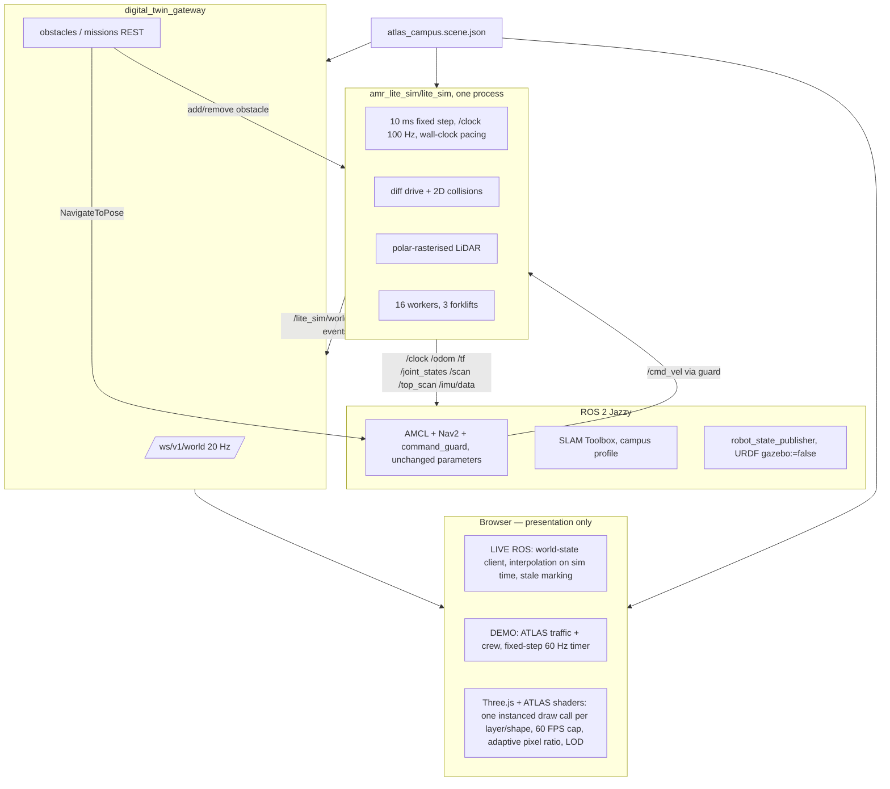

# Phase 6 — Lite runtime (Gazebo-free Digital Twin): implementation and validation

Plan: [PHASE_6_LITE_PLAN.md](PHASE_6_LITE_PLAN.md). Diagnostic: [PHASE_6_DIAGNOSTIC.md](PHASE_6_DIAGNOSTIC.md).
Evidence: `docs/digital-twin/evidence-phase6/` (ignored by Git, like earlier phases).
Everything below was measured on this machine (i5-10300H, 4 cores / 8 threads, Intel UHD for
display, GTX 1650 on nouveau). Nothing was committed or pushed.

## Result

| Metric | Gazebo full stack (before) | Lite full stack (after) |
|---|---|---|
| Real-time factor, stack + browser open | **0.24** | **1.000** |
| AMR wall-clock speed, desired 0.45 m/s | **0.134 m/s** | **0.448 m/s** |
| `/scan` / `/top_scan` / `/odom` wall rate | 5.4 / 3.6 / 17.9 Hz | 15.0 / 10.0 / 50.0 Hz |
| `/clock` stalls > 100 ms | 0 | 0 (largest gap 22 ms) |
| Machine CPU, AMR moving, browser open | 65 % | 42 % |
| Simulator process | Gazebo 164–172 %, 1.17 GiB | lite engine 31–37 %, 0.17–0.20 GiB |
| GTX 1650 (nouveau) | active (sensor rendering) | suspended (nothing rendered server-side) |
| Browser | 144 FPS uncapped (current page) | 59.8 FPS at the 60 FPS cap, frame p95 20.9 ms |
| WebSocket to the browser | 10 Hz (twin v2) | 20 Hz world-state v1, median latency 2.6 ms |
| Workers / forklifts simulated | 3 / 0 | 16 / 3 (ATLAS crew and lanes) |
| 12-mission soak with people, 50 min | not run (motion too slow) | 12/12 succeeded, 0 contacts, 1277 m |

Before: `evidence-phase6/baseline/`. After: `evidence-phase6/after_lite_full_stack/` (same scripts,
now in `src/amr_lite_sim/scripts/perf/`: `monitor_topics.py`, `sample_system.py`, `measure_fps.mjs`,
`ws_probe.py`; operations profile with
16 workers and 3 forklifts, one Nav2 mission running, browser on the LIVE page).

## Follow-up (2026-11-06): walls, AMR speed, route ownership, persistence

Evidence: `evidence-phase6/followup/` (ignored by Git). Persistence is documented in
[PHASE_2_STORAGE.md](PHASE_2_STORAGE.md) (recorder for the lite runtime, Compose storage, history CLI).

| Change | Before | After |
|---|---|---|
| Exterior walls in the default 3D view (fraction of each wall face drawn, `audit_walls.py`, dock doors excluded) | west/east 36 %, north 12 %, south 14 %; physical walls hidden; open runs up to 8.25 m at robot height | 100 % on all four walls ("Completas"); default "Automático" cuts only the walls between an outside camera and the hall down to the physical 3 m plinth |
| Rear (north) wall panels | 14 panels rotated 90° (7.1 m fins across the wall, 3.2 m into the hall at 1.6–11.5 m) | in the wall plane between the columns |
| Physical boundary | 3 m enclosure, north outer corners notched 0.35 × 0.35 m | same inner faces; corners closed; map v9 re-verified with identical residuals |
| AMR cruise (`desired_linear_vel`) | 0.45 m/s, measured 0.450 m/s straight | 0.60 m/s, measured 0.600 m/s straight (engine state) |
| Five station missions incl. workers, forklifts and a placed obstacle | 4/5 succeeded, 0.406 m/s overall, 989.7 s simulated | 5/5 succeeded, 0.528 m/s overall (+30 %), 769.8 s (−22 %), 0 contacts, RTF ≥ 0.998 |
| Route overlays | one toggle drew the forklift/fleet loops (static `routes` layer, minimap lanes) and the AMR plan | loops never drawn; "Rotas de navegação AMR" draws only AMR routes (LIVE: Nav2 plan + goal; DEMO: route ahead of each AMR) |

### Building walls

The building shell is described once, in `campus_navigation.mjs` (`SHELL`, `enclosure()`,
`upperWalls()`), and compiled into the scene: `enclosure` (0–3 m, the physical wall that bodies hit
and floor scanners see: west/east/north 0.7 m thick, dock wall 0.25 m between the eight dock doors)
and `walls_west|east|north|south` (3 m up to the roof line at 14 m, with a lintel above every dock
door, 8.4 × 5.2 m openings filled by the prototype's roll-up doors). `building.shell` in the scene
lists sides, layers, outward normals, inner/outer faces and the doors. The upper walls lie above
every simulated band (bodies ≤ 0.6 m, people 1.8 m, forklifts 2.0 m, scanners 0.21/0.48 m), so they
change no collision, scan, map or Gazebo world (`test_upper_walls_change_no_simulated_band`).

Defects found by the audit (`src/atlas_scene/scripts/audit_walls.py`, before/after JSON in
`evidence-phase6/followup/walls/`):
1. The default view hid the physical enclosure and showed only the prototype's cut-away walls: the
   side walls are open from y = −30.25 to 30.45 m, the rear wall has a 1.6 m gap at the floor and no
   panels at either corner (x < −55.75, x > 63.35), the dock wall has nothing between the doors.
2. Rear wall panels had width and depth swapped in `makeArchitecture` (fins across the wall). Fixed
   in `atlas_campus.mjs` (documented deviation from the prototype; count and colours unchanged).
3. The enclosure's north outer corners were notched (north wall 146 m long against side walls whose
   outer faces are at ±73.35 m); it now spans the outer faces. Inner faces unchanged.
4. Enclosure and rear columns share their faces (0.7 m), which z-fought when the enclosure was shown.
   Wall layers are drawn with a recessed material (`polygonOffset`) so coplanar columns and frames show.
5. The enclosure was 3 m high against 11.5–13 m prototype walls; the upper walls complete the height.

Wall presentation ("Paredes do galpão": Automático / Completas / Corte) is browser-only
(`scene.ts`, `wallVisibility`): Automático hides an upper wall only while the camera is outside the
building beyond that wall (the overview cuts two walls; first-person views from inside show all
four); Corte shows the plinth and the prototype cut-away; the plinth is always drawn. The engine's
walls never change. Checks: scene tests (shell closed except the doors, corners, doors = prototype
door panels), engine tests (`test_exterior_walls_stop_the_robot_and_are_seen_at_their_inner_face`:
for each wall the front scanner's centre beam measures the inner face within 2 cm and driving into it
ends in a structure contact inside the building), `register_campus_map.py` on the new scene (same
transform, residuals and enclosure fractions as v9; registration provenance updated to the new scene
hash), browser screenshots of every mode in DEMO and LIVE.

### AMR speed

Only `FollowPath.desired_linear_vel` changed (0.45 → 0.60 m/s). Unchanged and still active: curvature
regulation (min radius 1.0 m), cost regulation (0.6 m), approach slow-down (0.8 m), collision
detection up to the carrot (2 s), rotate-to-heading, the drive limits (0.70 m/s, 0.5 m/s²), the
command guard's 0.70 m/s rejection, the engine's personnel safety scanner and the simulation time
(RTF 1.0). Lookahead at 0.6 m/s is 0.9 m (1.5 s), inside its 0.5–1.1 m bounds.

Safety at the new speed: the protective field is sized from the speed (v²/(2·0.5 m/s²) + 0.3 m: 0.50 m
at 0.45 m/s, 0.66 m at 0.60 m/s; warning field +1.0 m, speed limited to 0.3 m/s); the safe stop brakes
at 1.5 m/s², i.e. 0.12 m from 0.6 m/s, inside the protective field. The dimensions follow the speed,
so no constant changed.

Same five missions, same start (spawn), operations profile (16 workers, 3 forklifts), engine-state
speeds via the Gateway (`run_missions.py`, now also reporting `straight_cruise_speed_m_s` and
`mean_speed_sim_m_s`); `evidence-phase6/followup/speed_{baseline_045,new_060}/`,
`speed_comparison.json`:

| Mission (what it exercises) | 0.45 m/s: status, simulated s, mean m/s, goal error | 0.60 m/s |
|---|---|---|
| spawn → charger_01 (straight hall and 60 m north cross aisle with forklift EMP-1, turns) | ok, 169.5 s, 0.429, 0.18 m | ok, 126.3 s, 0.572, 0.17 m |
| → pick_north_e1 (2.26 m rack aisle, worker COL-07 working in it) | **failed** (Nav2 104 after 8 recoveries, 0.41 m short) | ok, 82.1 s, 0.413, 0.12 m, 5 recoveries |
| → dock_05 (hall, south cross aisle and dock aisle with forklifts, dock workers) | ok, 250.3 s, 0.426, 0.27 m | ok, 206.1 s, 0.515, 0.20 m, 5 recoveries |
| → production_w (station to station across the campus) | ok, 229.1 s, 0.424, 0.17 m | ok, 180.6 s, 0.565, 0.15 m |
| → receiving_01 with a box placed 6 m ahead on the plan | ok, 238.5 s, 0.385, 0.16 m; stopped ~24 s, passed 1.2 m away | ok, 174.7 s, 0.525, 0.19 m; stopped ~11 s, passed 1.07 m away, no contact |
| Totals | 4/5, 0.406 m/s overall, straight cruise 0.450 m/s | 5/5, 0.528 m/s, straight cruise 0.600 m/s (median and p10) |

Contacts 0 in both, RTF 0.996–1.000; CPU per process group unchanged (Nav2 39.6 → 41.5 %, engine
27.0 → 26.8 %, Gateway 27.6 → 27.5 %, machine 17.6 → 16.6 % of 8 threads). Protective-field events (objects or people inside the field,
reported by the engine) 3 → 6 and recoveries 15 → 15 in total; one run each, so differences in
individual missions are within run-to-run variation of the people and forklift timing. The goal
error is ground truth against the station pose (AMCL error included), as before.

### Route ownership in the browser

AMR navigation (allowed): the Nav2 plan and goal of LIVE robots (`type === 'amr'` in world state),
the onboard view of that plan, the minimap plan; in DEMO the next 26 m of each AMR's own track
(`kind === 'amr'`, detours included). Non-AMR movement (never drawn): the forklift loops and the
prototype's fleet loops (`routes` layer: never uploaded; `scene.lanes`: kept for the engine and the
DEMO traffic, no longer drawn on the minimap), worker paths (never drawn). Painted floor markings
(`markings` layer: safety lanes, crosswalks, staging, parking) stay. The toggle is "Rotas de
navegação AMR"; vehicles, people, safety fields and walls are independent toggles.

### Browser evidence and checks

`evidence-phase6/followup/browser/`: `demo-before_*` (HEAD frontend, forklift and fleet loops drawn,
cut-away walls) against `demo-after_*`; `live_*` with a Nav2 mission (overview in each wall mode,
storage/docks/production presets, onboard view of the plan, AMR follow view with the route on and
off: dynamic instances 825 → 580, only the overlay disappears; forklifts EMP-1/2/3 moving at
1.45/1.30/1.35 m/s, their loops not drawn). `playwright_headed/`: the project's
`test/atlas.browser.ts`, extended with the wall modes (full: 4 walls, cut: 0, auto from the overview:
2) and the DEMO route toggle (725 → 525 dynamic instances), passed headed on the Intel GPU (DEMO and
LIVE: 54.9 / 54.5 FPS at the end of the run, WebSocket 20.0 Hz, latency 0.7 ms, RTF 0.999, obstacle
round trip, industrial and onboard cameras, follow). Headless Chromium renders with SwiftShader
(~3 FPS) here, so FPS is measured headed. Same-machine A/B with `measure_fps.mjs --headed` (DEMO
overview, two rounds): HEAD 59.99 / 59.75 FPS, new 59.76 / 59.76 FPS at the 60 FPS cap, frame p95
20.9 ms in both; draw calls 16 → 18 (recessed wall meshes), static instances 10,671 → 10,427.
Live scan check (`check_scan_geometry.py`, new scene): median and p90 distance of both scanners'
returns to the scene 0.02 m (grid resolution).

Tests: `atlas_scene` 11 (3 new), `amr_lite_sim` 24 (4 new), `amr_navigation` 31,
`amr_route_planner` 26, `digital_twin_gateway` 53 (colcon test: 145, 0 failures), frontend unit 25
(4 new), `npm run build`, browser 2 (headed), `build_graph --check`, recorder 23 (see the storage
document).

The Phase 5 warehouse graph records the SHA-256 of `nav2_params.yaml` as a source, so the speed
change made it stale (`build_graph --check` failed as designed). It was rebuilt deterministically:
only `graph_version` (31fba3aa050bd251 → 09de537d47d8038f) and the `nav2_params`/`planner_config`
source hashes changed; nodes, edges and statuses are identical. `route_planner.yaml` keeps its
Phase 5 turn weight (comment updated).

## What was built

| Package / area | Role |
|---|---|
| `src/atlas_scene` (new) | The single scene: Node compiler running the ATLAS builders (unchanged geometry, seed 42930, 10,659 instances — the count the prototype logs) plus LIVE data (wall cladding, spawn, 16 stations, 8 industrial cameras, corridors). Writes `config/atlas_campus.scene.json` and a byte-identical browser copy. Python loader verifies both hashes and slices geometry at any height. |
| `src/amr_lite_interfaces` (new) | `WorldState`, `EntityState`, `Obstacle(Array)`, `SimEvent`, `AddObstacle`, `RemoveObstacle`. |
| `src/amr_lite_sim` (new) | Lite engine (`lite_sim`), survey driver, free-space relay for mapping, launch files (`lite`, `lite_twin`, `lite_mapping`, `lite_navigation`), campus SLAM profile, survey plan, tools (map registration, scan-geometry check, Gazebo comparison, graph export, Route Server evaluation, mission runner). |
| `src/amr_navigation` | `command_guard`: `simulation_backend` parameter (`gazebo` default, `lite`); front scanner may report open space. `initial_pose`: repeats the estimate until AMCL is active. `navigation.launch.py`: `simulation_backend` argument. Campus map `maps/campus.{yaml,pgm}` + verified registration + provenance. The warehouse map is untouched. |
| `src/amr_description` | `sensors` xacro argument (`full` default, `lidar`), `bridge_config` launch argument, `config/bridge_lidar.yaml`. Defaults unchanged. |
| `src/amr_simulation` | `gazebo_validation.launch.py` and `scripts/generate_campus_world.py`. The warehouse worlds, manifest and scenarios are untouched. |
| `src/digital_twin_gateway` | world-state v1 (`/ws/v1/world`, `GET /api/v1/world`, `GET /api/v1/world/scene`), commands (`POST/DELETE /api/v1/obstacles`, `POST/DELETE /api/v1/missions`), world store, registration, GZip. Twin v1/v2 and route contracts unchanged. |
| `shared/schemas` | `world-state.v1`, `command-result.v1` (generated from the Pydantic models). |
| `web/digital-twin` | `index.html` = ATLAS twin (LIVE ROS / DEMO). The Phase 5 page moved unchanged to `diagnostics.html` (its browser tests now open it there). |



## Commands

Prepare each terminal: `cd ~/ros2_ws && source /opt/ros/jazzy/setup.bash && source .venv/bin/activate && source install/setup.bash`.
Build **with `.venv` active** (its own `colcon`, see [DEVELOPMENT.md](DEVELOPMENT.md)); `/usr/bin/colcon` rewrites the
console scripts to the system Python, which has no FastAPI/uvicorn, and the Gateway then dies at start
("No module named uvicorn"):

```bash
cd ~/ros2_ws && source /opt/ros/jazzy/setup.bash && source .venv/bin/activate
colcon build --symlink-install --packages-select atlas_scene amr_lite_interfaces amr_lite_sim amr_navigation amr_description amr_simulation digital_twin_gateway
head -1 install/digital_twin_gateway/lib/digital_twin_gateway/gateway   # expected: #!/home/<user>/ros2_ws/.venv/bin/python
```

```bash
# LIVE twin: lite engine + workers/forklifts + Gateway + AMCL + Nav2 + guard (no Gazebo process)
ros2 launch amr_lite_sim lite_navigation.launch.py            # profile:=empty for no agents
# Engine + Gateway only (no navigation)
ros2 launch amr_lite_sim lite_twin.launch.py
# SLAM mapping of the campus (no agents), driven by the coverage survey, 3x real time; scanner noise
# 1 cm by default here (lidar_noise_stddev). Run it on an otherwise idle machine: async SLAM skips scans under load
ros2 launch amr_lite_sim lite_mapping.launch.py survey:=true real_time_factor:=3.0
bash src/amr_navigation/scripts/save_map.sh /absolute/path/campus_candidate      # while SLAM runs
python3 src/amr_lite_sim/scripts/register_campus_map.py --map /absolute/path/campus_candidate.yaml --output reg.json
# After changing the robot model: re-export the onboard camera mount used by the browser (--check verifies)
python3 src/amr_lite_sim/scripts/export_robot_cameras.py
# Frontend (Node >= 22: export PATH=$PWD/.tools/node_modules/.bin:$PATH)
cd web/digital-twin && npm run dev     # http://127.0.0.1:5173 (LIVE ROS), ?mode=demo, /diagnostics.html
# Missions and obstacles from a terminal (same endpoints as the UI)
python3 src/amr_lite_sim/scripts/run_missions.py dock_05 charger_01 --output /tmp/missions.json
curl -X POST localhost:8000/api/v1/obstacles -H 'Content-Type: application/json' -d '{"kind":"pallet","x":2,"y":6}'
# Optional physical validation (headless, simplified campus, LiDAR-only AMR); then compare:
GZ_PARTITION=campus_validation ros2 launch amr_simulation gazebo_validation.launch.py
GZ_PARTITION=campus_validation python3 src/amr_lite_sim/scripts/compare_gazebo_lidar.py --output /tmp/cmp.json
# Scene recompilation (after editing the ATLAS builders or campus_navigation.mjs), then drift check
node src/atlas_scene/compiler/compile.mjs && node src/atlas_scene/compiler/compile.mjs --check
# Wall coverage audit of a compiled scene (layers as drawn); then re-verify the map against it
python3 src/atlas_scene/scripts/audit_walls.py src/atlas_scene/config/atlas_campus.scene.json \
  --layers architecture enclosure walls_west walls_east walls_north walls_south
python3 src/amr_lite_sim/scripts/register_campus_map.py --map src/amr_navigation/maps/campus.yaml --output /tmp/reg.json
# After any change to nav2_params.yaml: the Phase 5 graph records its hash (check, then rebuild)
ros2 run amr_route_planner build_graph --check || ros2 run amr_route_planner build_graph
# Telemetry recording and history (Mosaico): see PHASE_2_STORAGE.md
```

## Scene and coordinates

- **Source**: `atlas_campus.mjs` is the prototype's builder code with only the DOM writes removed;
  `campus_navigation.mjs` adds what LIVE needs. The compiler writes every instance in the ROS world
  frame and a `geometry_sha256` and `scene_sha256`; JavaScript and Python compute identical hashes.
  The Gateway serves the same bytes the engine loaded; the browser refuses LIVE geometry whose hash
  differs from the engine's (banner).
- **Axes**: ROS world x east, y north, z up. WebGL/Three.js X = x, Y = z, Z = −y; yaw is the same number
  (`web/digital-twin/src/atlas/coords.ts`). Map ↔ world: `map = R(yaw)·world + (x, y)` from
  `maps/campus_registration.json`, used only for the Nav2 plan and mission goals.
- **Physical model**: each prototype "solid" (racks, conveyor, cells, tables, stairs, fence, pallets,
  chargers, pillars, extinguishers) is the object's envelope: it stops bodies and is seen by floor
  scanners, as in the prototype's own traffic code. The building shell (follow-up section above):
  the physical 3 m `enclosure` and the upper walls `walls_<side>`; the browser always draws the
  enclosure and cuts the upper walls per side only for the view.
- **Temporary objects**: none are generated; cones, boxes and pallets exist only when a user places
  them. Permanent structure (racks with cargo, floor pallets, conveyor, cells, chargers, docks,
  trucks, mezzanine) is preserved. The 30 × 20 m warehouse and its Gazebo scenarios stay available
  for the Gazebo tooling only.

## Lite engine

- Fixed 10 ms step paced against the wall clock (`step/target_rtf`), `/clock` at 100 Hz, catch-up
  bounded at 25 steps; overruns and measured RTF go to `/diagnostics` and world-state.
- Differential drive with the robot's limits from `amr_dimensions.json` (0.7 m/s, 1.5 rad/s,
  0.5 m/s², 1.5 rad/s², 0.5 s command timeout), exact arc integration, wheel joint states, odometry
  and `odom → base_link` at 50 Hz with the controller's covariances.
- Collisions: footprint vs structure, obstacles, workers, forklifts; on contact the robot advances to
  the last free fraction of the step and stops (`blocked`, one `contact` event, `released` on backing away).
- LiDAR: both scanners at the URDF mounts; segments of the scene sliced at each scan plane; per scan,
  back-face culling plus polar rasterisation (beam interval per segment). Equal to a brute-force ray
  cast within 1 µm at 8 test poses; 0.4 ms per 720-beam scan.
- Workers: the prototype's behaviour (task stops: scan, pick, drop, inspect, kneel, signal, look
  around; waiting for vehicles; side-stepping objects), plus "never step into a body": a person
  stepping aside for a stopped vehicle moves sideways up to the side-step or the rack and passes
  where the aisle allows (a parked AMR in a 2.3 m rack aisle is passed after < 1 s); otherwise a
  blocked person slides back toward the walked line or stops, one held up for 10 s turns back along
  the walked route (`turned_back` event), and one touching a body may only step away from it. A
  head-on meeting in a rack aisle therefore cannot deadlock.
  Forklifts: the prototype's protective field, yielding, following, back-off and detours on their
  one-way lanes.
- Safety field per vehicle (speed-dependent protective v²/(2·0.5 m/s²) + 0.3 m, warning + 1.0 m),
  reported for every object. For **people** the AMR's field is enforced, as a safety scanner would,
  independently of Nav2: a person in the protective field triggers a safe stop at 1.5 m/s²
  (`protective_stop`, reason `protective_stop:<id>`), reset only when the standstill warning field
  (1.3 m) is clear of people; a person in the warning field limits the speed to 0.3 m/s; reversing
  is not limited. An in-place turn (|v| < 0.05 m/s) with a person inside the swept disc
  (circumscribed radius + 0.15 m) is refused (reason `rotation_stop:<id>`). User obstacles and
  forklifts are left to Nav2 (costmap, replanning) and to the geometric contact stop.
- Cost: 1.3 ms per step on average (p99 3.0 ms) with 16 workers, 3 forklifts and the safety checks
  (1.0 ms before the safety checks were added).

Bugs found and fixed during validation (each with a regression test or a measured re-run): stamp
rounding that made `/clock` jump back ~1 s at some integer seconds (TF buffers cleared; test
`test_time.py`); contact chattering (`test_collision_blocks_motion_and_emits_one_event`); integer
scene values in typed messages; a shutdown race; and, from the first soak (see "Soak"), an AMR–worker
deadlock in a rack aisle, contacts caused by in-place rotation next to a person, a person walking
into the AMR's path faster than Nav2 could react, and a person left pinned inside the margin of a
stopped AMR (`test_worker_steps_aside_and_passes_a_parked_robot`,
`test_worker_turns_back_when_a_parked_robot_blocks_its_side`,
`test_in_place_rotation_refused_with_person_in_swept_area`,
`test_safe_stop_for_a_person_in_the_protective_field`,
`test_person_pinned_against_a_robot_can_step_away`).

## Sensor validation

| Check | Result |
|---|---|
| Published scans projected through TF and ground truth onto the scene, robot moving (`check_scan_geometry.py`) | median and p90 point distance 0.02 m (one 2 cm grid cell), 30 front + 59 360° scans |
| Lite vs Gazebo `gpu_lidar`, same scene, 6 poses (`gazebo_validation`, `compare_gazebo_lidar.py`) | median |Δr| 1–8 mm; returns present on one side only: 0–2 beams per scan; |Δr| ≤ 5 cm on 79–100 % of beams (the rest at grazing incidence along the long aisles, where mm-level pose offsets after `set_pose` become cm) |
| Drive vs Gazebo `diff_drive_controller` (simulation time) | 0 → 0.49 m/s in 0.95 s (lite) vs 0.97 s; steady 0.500 m/s both; arc 0.4 rad/s commanded: lite 0.400, Gazebo odometry 0.349 (wheel contact; see limitations) |

## Campus SLAM and the map

| Survey | Configuration | Result |
|---|---|---|
| v1 | — | engine stamp bug (clock jumped back); discarded |
| v2 | Phase 5.1 SLAM parameters, front scanner | false loop closure after 22 m (8.7 m jump), 25 m peak error |
| v4 | loop closing off + Phase 5.1 tuned matcher | 27 m / 0.43 rad drift over 1160 m |
| short plan A–D (150–170 m) | front scan; odometry penalties; 360° scan; 360° scan without matching | 3.3 m; 3.7 m; 1.9 m / 0.05 rad (all while driving the aisles lined by identical rack ends); **0.000 m** |
| v5 | 360° scan, odometry poses | 1.7 cm max; verified; middle rack aisles unknown (beyond range) |
| v6 | + every middle aisle traversed | verified; north aisles still unknown: **Karto ignores +inf readings**, so open floor beyond range is never cleared |
| v7 (first installed) | + `free_space_relay` (no-return → range_max − 1 cm, SLAM max range 19 m) | SLAM vs ground truth max 3.4 cm over 1669 m; occupied cells median 0.00 m / p90 0.04 m from the scene, 100 % within 0.10 m, 0 % free cells inside solids, coverage 99.1 %; every station on free cells. **Withdrawn after the soak**: the north and west walls are missing (see below) |
| v8 | + range noise σ = 1 cm during the survey | all four walls mapped, but run next to other experiments: SLAM (async) integrated ~13 % fewer scans, the south-east dock area stayed partly unknown and `dock_07` fell on an unknown cell; rejected |
| **v9 (installed)** | v8 on an idle machine | SLAM vs ground truth max 2.9 cm over 1654 m; occupied cells median 0.02 m / p90 0.04 m, 100 % within 0.10 m, 0 % free cells inside solids, coverage 99.2 %; walls mapped north 98.8 % / south 100 % / west 100 % / east 95.6 %; all 16 stations and the spawn on free cells (registration `89768ddd2c7518fe`) |

**Missing walls in v7.** The lite LiDAR is exact, so every return from a wall lands exactly on its
face. Karto sizes the grid as round(extent / resolution); returns lying exactly on the two maximum
faces of the bounding box (map +x = world north wall, map +y = world west wall) fall one cell past the
grid and are dropped, so those walls were absent (0 % of the face mapped) while the south and east
walls were present. The registration check did not see it: it only sampled cells inside the image and
inside the interior bounds. AMCL scores off-map endpoints as "far from any obstacle", so along the
north corridor the main reference vanished; with no people at all, AMCL tracked within 0.4 m for
170 m and then diverged to 5.5 m / 0.75 rad within 10 s at world (52–55, 49.6)
(`evidence-phase6/amcl_north_corridor/`). Fixes: 1 cm range noise during the survey (real scanners
are never exact; returns now straddle the faces), and an enclosure check in `register_campus_map.py`
(each wall face, found as the first surface along its normal, must be mapped within 0.10 m; a face
outside the image counts as missing; minimum 80 % per wall). On v7 that check reports north 0 %,
west 0 %, south 96 %, east 89 %.

The installed map is SLAM Toolbox output on lite scans (`amr_navigation/maps/campus.*`, provenance
in `campus_provenance.json`). Scan matching is disabled for the campus because, with exact lite
odometry, it measurably degraded the pose in this mirrored, repetitive layout. A robot with real
odometry would need matching and more distinctive features (or landmarks) in this campus.

## Navigation validation (one AMR, Nav2, through the Gateway)

| Run | Result |
|---|---|
| Missions, no agents (v5 map): dock 05, charger 01, production | 3/3 succeeded, 0 recoveries; 60.7 / 112.4 / 93.4 m at 0.41 / 0.40 / 0.43 m/s wall average; final error 0.32 / 0.18 / 0.17 m |
| Pallet placed on the plan 6 m ahead, dock aisle (7 m wide) | robot paused ~5 s, replanned and passed 1.4 m to the side (min. centre distance 1.43 m), succeeded, no contact |
| Pallet in the 3.2 m charger aisle (only mapped access) | robot stopped ~0.3 m short, Nav2 aborted after 8 recoveries with a reason; no contact |
| Operations profile (16 workers, 3 forklifts), v7 map: picking north 1 (worker COL-01 walks that aisle) | succeeded, 74.8 m at 0.43 m/s average, 1 recovery, 0 contacts, final error 0.14 m |
| 12-mission soak with workers and forklifts | see "Soak" |

Before these runs two real defects were fixed: the guard rejected an all-+inf front scan as "stale"
(open campus halls: the front scanner legitimately sees nothing within 20 m; the 360° scanner keeps
the blind-sensor check), and the initial pose was dropped when AMCL was configured but not yet active
(large map). A third defect surfaced later under CPU load (soak investigation): the guard subscribed
to `/amcl_pose` as volatile, while AMCL publishes its estimate once and then only after motion; if
the guard matched late it never received a pose and blocked every command, so the robot could never
move (`test_pose_latched_before_the_guard_starts_is_received`; the guard now subscribes
transient-local, which also applies to the Gazebo mode).

## Graph and Nav2 Route Server

`build_campus_graph.py` builds the circulation graph from the scene corridors: 158 nodes (58
crossings/T-junctions, 16 stations, accesses, corridor ends), 372 directed edges, costs = length ×
1.5 on capacity-1 rack aisles, every edge validated by sweeping the footprint + 0.30 m clearance
against the scene. Three connections are rejected for real obstructions (mezzanine stairs in aisle
e51, the production aisle extension into a rack). It exports GeoJSON in the map frame.

`evaluate_route_server.py` runs `nav2_route` 1.3.13's `route_server` on that file: **240/240
station-pair requests succeeded, 240/240 costs equal an independent Dijkstra**, 234 identical node
sequences (6 equal-cost alternatives), planning time median 0.41 ms, max 1.04 ms. Missions currently
use `NavigateToPose` (Nav2 plans the geometry on the costmap); routing missions through the Route
Server's `ComputeAndTrackRoute` is the recommended next step and needs no change to the graph.

## Gateway (world-state v1)

Contract in `shared/schemas/world-state.v1.schema.json`: session/sequence/timestamps, simulation
(backend, status, availability, sim time, measured RTF, overruns, scene hash, age), connection
(Gateway, ROS, simulation, navigation, registration), entities (pose, velocity, state, activity and
progress, carrying, head look, safety field), robots (interlock, Nav2 plan in world frame or the
reason it is omitted, mission), user obstacles, last 50 events by sequence. 20 Hz, one serialisation
per tick. Commands are validated (strict models, 422 on unknown fields), the backend decides
(201/409 with its reason), the browser never applies a change first. Without ROS the Gateway keeps
serving and marks everything stale/offline; the engine keeps running without the Gateway; browsers
reconnect with backoff and resynchronise from the next snapshot.

## Frontend

- One render loop that only interpolates (simulation time, 120 ms behind, never extrapolated or
  rewound) and draws; phase-keeping 60 FPS cap; adaptive pixel ratio; dynamic instances written into
  preallocated typed arrays; distant workers drawn with 5 instances instead of ~60 (LOD); labels every
  3 frames, minimap every 9, panels every 12. 16–22 draw calls, ~10.7 k static + ~250–720 dynamic instances.
- DEMO runs the prototype's traffic on a fixed 60 Hz timer (independent of frame rate; the prototype
  slowed below 14 FPS). LIVE runs no simulation and dims everything when data is stale or offline.
- Camera views (below): first person from every industrial camera and from each AMR's onboard
  RGB-D camera; the camera coverage drawings (floor polygons, outlines, frustum rays, minimap
  coverage, their layer toggle) were removed. No image stream or detection is simulated.
- Walls: "Paredes do galpão" Automático (default) / Completas / Corte; routes: "Rotas de navegação
  AMR" (AMR overlays only). See the follow-up section.
- Tests: `npm test` (25 unit), `npm run build` (types, schema drift, bundle),
  `TWIN_ATLAS_EVIDENCE_DIR=... npx playwright test test/atlas.browser.ts --headed` (DEMO and LIVE).
  Screenshots: `evidence-phase6/frontend/`, `evidence-phase6/first_person/`.

### First-person camera views

One Three.js camera and one render loop, placed per frame by `ViewController.ts` from
`cameraPoses.ts` (ROS → WebGL through `coords.ts` only):

| Mode | Camera pose | Optics |
|---|---|---|
| Overview | orbit camera (unchanged) | 47° vertical, canvas aspect |
| Follow an entity | orbit camera following it (unchanged) | idem |
| Industrial camera | lens at the scene's mount position, scene yaw and depression | scene horizontal × vertical aperture (85° × 52°), framed with the camera's own aspect between the panels |
| Onboard camera (AMR) | robot pose ⊕ URDF `base_link → camera_optical_frame` (0.477 m ahead, 0.264 m up; REP 103 optical axes) | 75° horizontal, 640×480 square pixels → 59.9° vertical, 4:3 framing |

- The onboard mount is not restated in the browser: `amr_lite_sim/scripts/export_robot_cameras.py`
  composes the URDF's fixed joints (xacro, full roll/pitch/yaw) into
  `web/digital-twin/public/robots/amr.cameras.json`; `--check` and `test_robot_cameras.py` fail if it
  drifts from the URDF, and check the optical convention.
- LIVE: the onboard pose is the same interpolated backend state that is drawn (simulation time,
  never extrapolated); a stale or vanished robot keeps the last pose and the HUD says the data are
  outdated. DEMO: the prototype's vehicles (1.64 m) are not the URDF robot, so the lens is at the
  demo vehicle's nominal front with the URDF height, orientation and optics.
- Switching blends position, orientation, FOV and framing over 0.6 s, then holds the lens exactly.
  In first-person views dragging and the wheel never leave the view; "Olhar ao redor" is an explicit,
  reversible gaze offset that does not change the sensor's orientation. Keys: C (next camera),
  V (onboard camera of the selected or first AMR), Esc (overview). Clicks still select entities and
  place objects through the framed viewport.
- From a robot's own lens its protective-field outline would sit on the image, so that one robot's
  outline is not drawn while looking through its camera (the field itself is unchanged and drawn in
  every other view); the Nav2 path is drawn on the floor instead of 0.17 m up.
- CAM-01 was mounted at the centre of pillar (−71, 51); its lens is now on the pillar's east face
  (−70.29, 51, 9), same target. `test_industrial_camera_lenses_are_free_of_structure` checks that
  no lens sits inside a solid and that the first metre of each optical axis is clear. Building
  geometry (and its hash) is unchanged; the map registration was re-recorded for the new scene hash.

Validation in a headed Chromium (Intel GPU) against the running lite stack
(`evidence-phase6/first_person/`, `fp_validation.json`):

| Check | Result |
|---|---|
| All 8 industrial cameras in first person, no coverage geometry | 8/8; next-camera cycles; drag and wheel keep the view and orientation; look-around turned 48° at the same lens position and realigned exactly |
| Onboard camera during a Nav2 mission (dock_05, 0 recoveries, succeeded), turns over the whole yaw range | 284 samples, 261 moving; camera vs URDF lens of the drawn robot (same frame): max 0.07 mm, heading max 3.6 × 10⁻⁶ ° |
| Drawn robot vs backend state | 284/284 within the drive limits × the interpolation delay; 1.9 cm when stopped |
| Box placed by clicking the floor inside the onboard view | accepted by the backend; Nav2 replanned around it (screenshots `fp_onboard_obstacle_*`) |
| Gateway stopped while looking through the onboard camera | "GATEWAY DESCONECTADO", HUD "DADOS DESATUALIZADOS", camera frozen at the last pose |
| DEMO: onboard (V), industrial (C), Esc | works; onboard view follows the moving demo AMR at 60 FPS |
| Page errors | 0 |

Frame rate and GPU, same probe before and after (LIVE, 1600×900, Intel UHD; `perf_before.json`,
`perf_after.json`):

| View | FPS | frame p95 | draw calls | triangles | Intel GPU busy |
|---|---|---|---|---|---|
| Overview, before → after | 60.0 → 60.0 | 20.9 → 20.9 ms | 40 → 16 | 161 k → 160 k | 95 → 96 % |
| Industrial CAM-06, before ("view from camera") → after | 60.0 → 60.0 | 20.9 → 20.9 ms | 38 → 16 | 181 k → 179 k | 98 → 96 % |
| Onboard camera AMR-01 (new) | 60.0 | 20.9 ms | 16 | 181 k | 96 % |

The 24 coverage meshes (3 per camera) were the draw-call difference. The views are renderings, not
sensor images: the RGB-D streams exist only with the Gazebo backend and `sensors:=full`
(`/camera/image_raw`, `/camera/depth/image_raw`, `/camera/camera_info`, frames
`camera_optical_frame` / `camera_depth_frame`; listed in `amr.cameras.json`). Integrating them later
would mean a Gateway subscription forwarding compressed frames to a separate "imagem do sensor"
panel; the first-person view does not depend on them. The industrial cameras' `future_topic` names
are placeholders (no publisher).

## Soak

Twelve consecutive Nav2 missions through the Gateway (`run_missions.py`: dock_03, charger_02,
pick_south_w1, production_w, dock_07, pick_north_e1, receiving_01, charger_04, pick_south_e1,
dock_01, pick_north_w2, charger_01; ~1.2 km), operations profile (16 workers, 3 forklifts), LIVE
page open in Chromium, system/topic/browser sampling for 50 min. The first three runs failed; each
failure was traced to a defect, fixed, and covered by a test before the next run.

| Run | Result | Cause found | Fix |
|---|---|---|---|
| 1 (`soak_v1_deadlock/`) | 0/12; AMR held in contact with worker COL-01 in the x = −55 rack aisle for the whole run | head-on AMR–worker deadlock in a 2.3 m aisle; Nav2 turning in place next to the person | worker turn-back after 10 s; rotation stop with a person in the swept disc |
| 2 (`soak_v2_pinned_worker/`) | 2/12; contact with COL-03 at 0.45 m/s in the x = −61 aisle, then stuck | a person stepping in front of the AMR faster than Nav2 could react (RPP flagged "collision ahead" only at impact); the person then stayed pinned inside the AMR's margin | personnel safety stop (protective/warning field, people only); a person touching a body may step away |
| 3 (`soak_v3_localization/`) | 6/12, **0 contacts**, 660 m, RTF 0.99–1.01; then a stop in a busy aisle (Nav2 gave up after 8 recoveries in 47 s) and loss of localization in the north-east corridor | missing north/west walls in the v7 map (above); people do not step aside far enough in rack aisles | v9 map + enclosure check; people step sideways to the rack face and pass |

Investigating run 3 also exposed the command-guard pose race (above) and an accounting error in
`run_missions.py` (each mission re-counted earlier contacts from the event ring; now only events
newer than the mission start are counted).

**Run 4 (`soak/`, v9 map, all fixes): 12/12 missions succeeded, 0 contacts.**

| Measure (50 min) | Result |
|---|---|
| Missions | 12/12 succeeded; 1277 m in 3122 s of missions, 0.41 m/s wall average (0.37–0.43 per mission); 0–10 Nav2 recoveries per mission (people in aisles) |
| Safety | 0 contacts; 9 protective-field events (objects or people entering the AMR's protective field while moving) |
| Final position (ground truth vs station) | median 0.16 m, ≤ 0.33 m for 11/12; 0.71 m at pick_south_e1, accepted by Nav2 (0.2 m tolerance), i.e. AMCL ~0.5 m off along that rack aisle |
| Real-time factor | 0.997–1.005 per mission; browser-reported minimum 0.988 |
| Topic rates | `/scan` 15.00, `/top_scan` 10.00, `/odom` 50.00, `/imu/data` 50.00, `/cmd_vel` 20.00, poses 20.00 Hz; largest gap 134 ms (`/top_scan`) |
| CPU | machine mean 55 %, p95 61 %; Nav2 80 %, browser 128 %, Gateway 53 %, engine 47 %, guard 33 % of one core |
| Memory growth over 50 min | engine +4.3 MiB, Gateway +3.7 MiB, Nav2 +14 MiB, browser +30 MiB (JS heap 27.7 → 32.6 MB); machine memory used did not grow |
| Browser (LIVE, headed Chromium) | 60.0 FPS mean, 59.6 min, frame p95 20.9 ms, 0 page errors, WebSocket 19.9 Hz, median latency 2.0 ms, always connected |
| GPU | Intel UHD 94 % busy on average at 60 FPS (little headroom); GTX 1650 suspended throughout |

Screenshot after 50 min: `soak/browser.png`.

## Tests run for this phase

`atlas_scene` 8, `amr_lite_sim` 20, `digital_twin_gateway` 53, `amr_navigation` 31,
`amr_route_planner` 26, `amr_simulation` generation 21, `validate_urdf.py` PASS, frontend unit 21,
browser DEMO + LIVE 2. Not re-run: the Gazebo warehouse launch/acceptance suites (Gazebo-only,
unchanged code paths except the defaulted `sensors`/`bridge_config` launch arguments).

## Limitations and possible regressions

- Lite physics is kinematic: no wheel slip, tipping or pushing; contacts are geometric stops. Gazebo's
  odometry shows 13 % lower yaw rate in combined arcs; physical studies belong in `gazebo_validation`.
- Lite LiDAR is ideal 2D: no divergence, reflectivity or motion distortion (noise optional).
- No RGB-D or industrial-camera images in lite mode: first-person views are 3D renderings from the
  lens poses (far plane 260 m, not the RGB-D 10 m clip), with no lens distortion or exposure.
- The prototype's raised, emissive forklift lane loops are no longer drawn (route ownership); the
  physical floor markings remain. The building geometry was changed only as listed in the follow-up
  section (rear wall panel orientation, closed corners, upper walls).
- Campus SLAM uses odometry poses (scan matching measurably worse here); not representative of a real
  robot's SLAM in this layout.
- Workers and forklifts are scripted. People always step aside to their right; a worker who cannot
  pass that way turns back after 10 s and may come back later.
- The safety scanner is idealised: rectangular fields, perfect person detection, no response time,
  people only. Objects and forklifts in the field are reported but not enforced.
- Only `amr_01` is integrated with Nav2 (by design for this phase); the engine and contracts accept more.
- Missions use direct `NavigateToPose`; the Route Server is evaluated but not yet in the mission loop.
- The browser page `/` changed: the Phase 5 diagnostics UI is now at `/diagnostics.html`.
- `command_guard` behaviour changed for the front scanner (open space accepted) and receives the
  latched AMCL pose (transient-local); Gazebo mode keeps its defaults otherwise. `initial_pose` now
  repeats its estimate until AMCL answers.
- The ATLAS follow camera can end up behind racks (prototype behaviour, kept).
- AMCL can be ~0.5 m off along long rack aisles (repetitive geometry); one soak mission ended 0.71 m
  from its station while Nav2 reported success.
- The LIVE page keeps 60 FPS but uses ~94 % of the Intel UHD; weaker integrated GPUs may need the
  adaptive resolution to drop or a lower FPS cap.
- Nav2 needs up to 10 recoveries to get through aisles with people; missions succeed, but slower
  (0.37 m/s instead of 0.43 m/s average) in the busiest ones.
